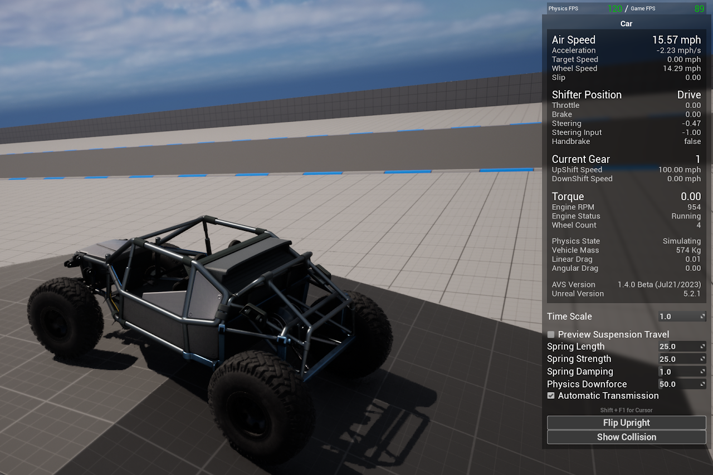

# Debugging

The tools for finding out why a vehicle is not behaving, followed by known problems and their fixes.

## Config Assist HUD

`VehicleSetup_HUD` shows the vehicle's state while you drive, and has sliders for the suspension.

<!-- side-by-side:57 -->
Turn on **Display Debug Menu** under **Advanced Vehicle System → Debug**. The HUD appears when a local player possesses the vehicle, and is removed when possession ends. `ShowDebugMenu` shows or hides it at runtime.

Adding the widget from a player controller, as in step 5 of the [Quick Start](https://overtorque-creations.com/Dev/Docs/#AVS/Getting_Started/Quick_Start.md), also works.

The HUD shows speed, shifter position, current gear and torque. A vehicle in Park with the engine off is a different problem from one in Drive producing no torque.

Press **Shift + F1** to get the mouse cursor, so you can use the sliders.
<!-- split -->

<!-- /side-by-side -->

The spring sliders set every wheel at once, replacing each wheel's own values. They are not saved. Copy the values back into the wheel components when you are done.

## Debug Visualizers

Under **Advanced Vehicle System → Debug** on the vehicle:

- **Visualize Center of Mass** draws the center of mass the physics body is using. It cannot be seen any other way.
- **Suspension Debug** draws each wheel's trace (orange when it hits, red when it misses), a line for each wheel's force, and each wheel's current spring length. Development builds only.

On each wheel, **Editor Preview** draws the wheel at both ends of its suspension travel in the viewport. It needs **Wheel Static Mesh** to be set.

## Profiling

`stat AVS` shows timings for AVS's work, and counts active vehicles and wheels. See [Tick and Performance](https://overtorque-creations.com/Dev/Docs/#AVS/Advanced/Tick_And_Performance.md).

`stat Physics` shows the engine's physics cost, and `stat FPS` the frame rate.

## Finding What Is Pushing a Vehicle

Select `VehicleMesh`, add its **On Component Hit** event, and print **Other Component** to the screen. Reproduce the problem, and the print names the component doing the pushing.

## Fixing Vehicle Problems

### Vehicle Shakes, Jitters or Bounces While Parked

These four causes come up repeatedly in support. Check them in this order:

1. Vehicle mass is too low. Under `1000` kg is very light for a car. See [Physics](https://overtorque-creations.com/Dev/Docs/#AVS/Configuration/Physics.md).
2. Tire friction is too high. Put **Tire Friction** back to `1.4`, and confirm the shaking stops before tuning it again.
3. The recommended project physics settings are not applied, substepping in particular. See [Project Settings](https://overtorque-creations.com/Dev/Docs/#AVS/Getting_Started/Project_Settings.md).
4. The springs are too soft for the mass, so the vehicle sits on fully compressed springs. Raise **Spring Strength** until it sits about halfway through its travel.

If all four check out and it only shakes while standing still, try the vehicle in a new project. Physics sleep behavior has changed between engine releases, and has caused this before.

### Vehicle Does Not Move

Check that the engine is running and the shifter is in Drive. A vehicle spawns with the engine off and in Park. Then check that at least one wheel has **Is Driving Wheel** on.

### Vehicle Stops Responding While Moved by Something That Does Not Possess It

It went passive. See [Keeping a Vehicle Awake](https://overtorque-creations.com/Dev/Docs/#AVS/Advanced/Tick_And_Performance.md).

### Vehicle Is Shoved Around by a Character

A character attached to the vehicle still has collision on. Turn it off on the character's mesh, capsule and weapons. See [Attaching Objects](https://overtorque-creations.com/Dev/Docs/#AVS/Components/Attaching_Objects.md).

### Vehicle Rocks Back and Forth on Another Physics Object

Turn off **Wheels Push Physics**.

### Physics Wheels Bounce or Shake at Speed

Give the wheel mesh a simple sphere collision. See [Important Information](https://overtorque-creations.com/Dev/Docs/#AVS/Getting_Started/Important_Information.md). Lowering the project's contact offsets also helps. See [Project Settings](https://overtorque-creations.com/Dev/Docs/#AVS/Getting_Started/Project_Settings.md).

### Physics Wheels Hit Curbs Harshly

A physics mode wheel is a solid body, and hits a curb with no tire deforming over it. Raycast wheels do not have this behavior.

### Physics Wheels Stop Getting Faster

Raise **Max Angular Velocity** in the project's physics settings. See [Project Settings](https://overtorque-creations.com/Dev/Docs/#AVS/Getting_Started/Project_Settings.md).

### Skeletal Mesh Parts Jitter Violently

Physics constraints are defined inside the skeletal mesh's Physics Asset. Move them to the vehicle Blueprint, connected to `VehicleMesh`. See [Important Information](https://overtorque-creations.com/Dev/Docs/#AVS/Getting_Started/Important_Information.md).

### Skeletal Wheels Sit or Size Wrong

A bone has a scale other than `1.0`. Apply the scale in your modeling software and re-export.

### Inputs Do Nothing in Multiplayer

The input function is called on a client that does not own the vehicle. See [Networking](https://overtorque-creations.com/Dev/Docs/#AVS/Advanced/Networking.md).

### Actors Disappear Around a Driving Player

Check that **Use Client Side Camera Updates** is on, or switch to server side relevancy. See [Network Relevancy](https://overtorque-creations.com/Dev/Docs/#AVS/Advanced/Networking.md).

## Getting Support

If none of this covers it, ask in the `#avs_support` channels on [Discord](https://discord.gg/8YvWARS), or send an email.

Include your Unreal version, your AVS version, and whether you are using raycast or physics wheels.
