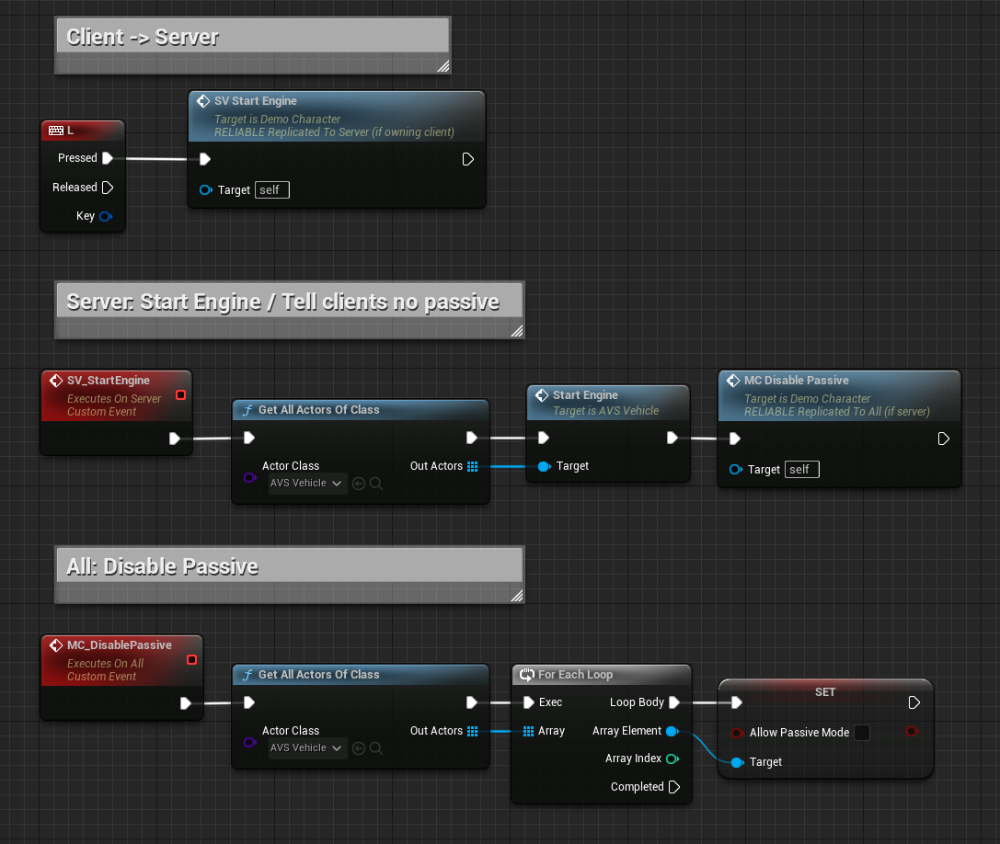
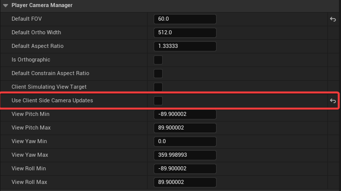

# Networking

How AVS vehicles replicate in multiplayer, where input functions have to be called from, and what to change when something desyncs. AVS vehicles replicate without any extra setup.

Every network setting is listed in [Vehicle Settings](https://overtorque-creations.com/Dev/Docs/#AVS/Reference/Vehicle_Settings.md).

## How AVS Replicates a Vehicle

Server and clients never simulate physics identically, so AVS does not try to keep every machine's simulation in step.

The machine that controls the vehicle simulates it and sends its state (location, rotation and velocity) 20 times a second by default. That is the client possessing it, or the server for a vehicle nobody possesses. Every other machine moves its copy of the vehicle toward those states.

Inputs (throttle, brake, steering, handbrake and shifter) replicate separately, so every machine knows what the driver is doing.

When a vehicle comes to rest, it stops sending states and sends one final resting position instead. See Vehicles at Rest below.

## Calling Input Functions in Multiplayer

In multiplayer, call input functions on the owning client (the client possessing the vehicle) or on the server.

<!-- side-by-side:57 -->
`SetThrottleInput`, `SetBrakeInput`, `SetSteeringInput` and `MoveShifterInput` do nothing when called anywhere else, with no error. `isOwningClient` returns whether the current machine is the owner.

`SetHandbrakeInput` and `SetShifterInput` do not check. On a non-owning client they change only that client's copy, and the server ignores them.

`Hitch` and `HitchToOverlapped` follow the same rule: call them from whoever owns the towing vehicle, or from the server.
<!-- split -->

<!-- /side-by-side -->

Throttle, brake and steering are rounded to steps of `0.1` before they are sent. The controlling client steers with its raw steering input. Only the replicated copy is rounded.

## Changing a Vehicle You Do Not Own

To change a vehicle from a client that does not own it, such as starting the engine of a parked car, go through an actor the client does own.

Put a Server RPC on the player's own pawn or controller. The server then makes the change on the vehicle, and multicasts the result if clients need to react.

## Network Type

**Network Type** decides how other machines follow the states they receive.

`History Interpolation` (the default) buffers the states and plays them back slightly behind the owner, blending from one to the next. Remote vehicles are always shown a little behind where they really are.

`Client Prediction` is unfinished in the current version. It draws a debug arrow over every remote vehicle.

## Tuning Replication

These settings are under **Network → Advanced**:

| Setting | Default | Higher | Lower |
|---|---|---|---|
| **Net Send Rate** | `0.05` s | Fewer states sent, less bandwidth | More states sent |
| **Net Time Behind** | `0.15` s | Absorbs more jitter and packet loss, further behind | Closer to the owner, bad connections show more |
| **Net Lerp Start** | `0.35` s | Blends toward each state for longer | Local physics runs longer before blending |
| **Net Position Tolerance** | `0.1` cm | Skips larger differences | Corrects smaller differences |
| **Net Smoothing** | `10` | Corrects faster | Corrects more gently |

With many vehicles, **Net Send Rate** has the largest effect on bandwidth.

States are sent with unreliable RPCs. Under heavy network load, unreliable packets are the first to be dropped, and a dropped state is replaced by the next one.

## Vehicles at Rest

A vehicle that has stayed below **Rest Velocity Threshold** (`25` cm/s, under **Physics → Advanced**) for 3 seconds stops sending states. It sends its resting position once, reliably, and again only if it moves more than about 50 cm while awake, or 0.5 cm while its physics sleeps.

Other machines move the vehicle to that exact position. A vehicle that was slightly out of place while moving ends up in the right place when it stops.

A vehicle creeping slower than the threshold also counts as at rest. If slow vehicles drift out of sync, lower the threshold.

## Trailers

Trailer replication is automatic once a hitch connects. A hitched trailer does not send states of its own. The owner of the towing vehicle sends the trailer's angle at the hitch instead, 5 to 20 times a second depending on how fast the trailer is turning, and once when both vehicles are at rest. Other machines turn the trailer toward that angle while it moves slower than 1000 cm/s.

Trailer chains (a trailer towing another trailer) work in single player, but are untested in multiplayer and likely do not work there.

## Turning Off Movement Replication

`SetMovementReplicationEnabled(false)` pauses movement replication for one vehicle. It does not change the **Movement Replication** setting, and `true` resumes it.

Pause it when something else moves the vehicle: a cinematic, attaching it to another actor, your own movement code, or constraints holding it to another vehicle. Without pausing it, AVS and the other system fight over the vehicle's position.

A vehicle held to another vehicle by your own constraints needs this. The server and clients otherwise fight over its position, the vehicle lags behind, and eventually its physics explodes. [Attaching Objects](https://overtorque-creations.com/Dev/Docs/#AVS/Components/Attaching_Objects.md) covers carrying a vehicle in multiplayer. Trailers on the hitch system do not need it.

To use another replication plugin, turn off **Movement Replication**. It turns off only location, rotation and velocity. AVS keeps replicating the inputs, and the plugin replicates the transform.

## Network Relevancy

Unreal decides which actors are relevant to a client from where the server thinks that client's camera is. By default it relies on the client sending camera updates.

AVS handles this the same way Chaos Vehicles does. While a client drives, the vehicle has the player camera manager send the server camera updates, so actors around the player are not culled. This needs **Use Client Side Camera Updates** on the camera manager, which is Unreal's default.

Server side relevancy is an alternative:

1. Create a Player Camera Manager class, or open the one you use.
2. Set your player controller to use it.
3. Turn off **Use Client Side Camera Updates** on it.

The server then works out relevancy itself, for every pawn type.

Raising **Net Cull Distance Squared**, or marking actors **Always Relevant**, hides a stale camera location without fixing it, and costs bandwidth.

## Fixing Networking Problems

### Inputs Do Nothing on a Client

The input function is being called on a client that does not own the vehicle. Call it on the owning client, or go through a Server RPC as in Changing a Vehicle You Do Not Own.

### Actors Disappear Around a Driving Player

Check that **Use Client Side Camera Updates** is on, or switch to server side relevancy.

### Carried or Towed Vehicle Lags Behind and Explodes

Turn off movement replication on it with `SetMovementReplicationEnabled(false)` while it is attached.

## Next Steps

- [Attaching Objects](https://overtorque-creations.com/Dev/Docs/#AVS/Components/Attaching_Objects.md): carrying a vehicle in multiplayer.
- [Hitch / Trailers](https://overtorque-creations.com/Dev/Docs/#AVS/Components/Hitch_Trailers.md): towing.
- [Vehicle Settings](https://overtorque-creations.com/Dev/Docs/#AVS/Reference/Vehicle_Settings.md): every network setting.
