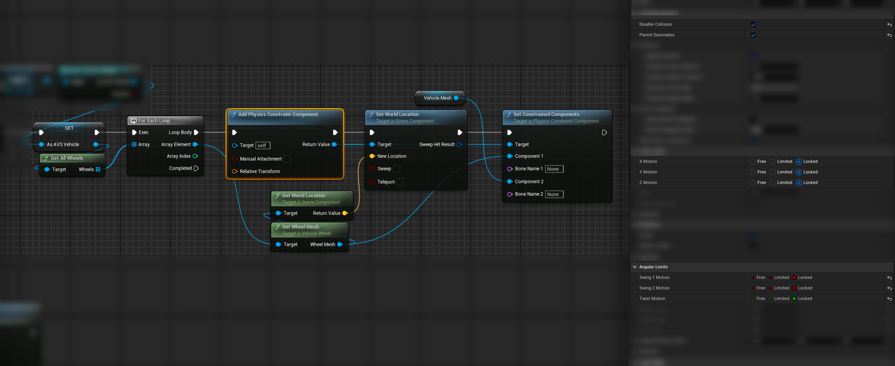

# Attaching Objects to a Vehicle

How to attach objects such as plows, roof racks, cargo, weapons and seated characters to a vehicle, and how to carry one vehicle on another.

The rules come from Unreal's physics. Getting them wrong makes a vehicle handle strangely or shove other objects around.

## Welded and Unwelded Objects

An object attached to a vehicle is either welded or not, depending on what it is attached to.

A welded object's collision becomes part of the vehicle's physics body. Its shape and mass count in the vehicle's simulation.

An unwelded object follows the vehicle without affecting its physics.

## Welding a Collision Mesh to the Vehicle

Attach the collision mesh directly to `VehicleMesh`. It welds to the vehicle's body.

A snow plow welded to the front of a truck adds its collision to the truck. The truck can push snow with it, and the plow's weight is part of the simulation.

A mesh attached to a skeletal mesh does not weld.

## Skeletal Meshes Cannot Weld

`VehicleMesh` is always a static mesh, and a skeletal mesh cannot weld to it. Skeletal meshes are attached to `VehicleMesh` as children, and AVS turns off their collision by default. See [Important Information](https://overtorque-creations.com/Dev/Docs/#AVS/Getting_Started/Important_Information.md).

If a skeletal part needs to affect the vehicle's physics, either:

- add a static collision mesh directly to `VehicleMesh`, and move it to follow the bone, or
- join the part to `VehicleMesh` with a physics constraint.

## Characters Riding on a Vehicle

Turn off collision on every part of a character attached to a vehicle: its skeletal mesh, capsule and any weapons. In multiplayer, turn it off on clients as well as the server.

A character attached with collision on acts as an immovable object. It pushes simulated objects of any weight around, including the vehicle it is riding.

To find what is pushing a vehicle, see [Finding What Is Pushing a Vehicle](https://overtorque-creations.com/Dev/Docs/#AVS/Advanced/Debugging.md).

## Carrying a Vehicle on Another Vehicle

A vehicle loaded onto a flatbed is held on with physics constraints. There are two ways to do it.

<!-- side-by-side:50 -->
**Constraining the body**

One physics constraint holds the carried vehicle at a point on the carrier. Give it a limited Z so the vehicle can move a little under load, and set the carried vehicle's wheels to physics mode so its weight rests on them.

Simpler to set up.
<!-- split -->
**Constraining each wheel**

One locked constraint per wheel holds each wheel on the carrier. The carried vehicle settles on its own suspension and moves with the carrier like a real load.

Looks better, and takes more setup, especially in multiplayer.
<!-- /side-by-side -->

## Constraining a Carried Vehicle's Wheels

For each wheel of the carried vehicle:

1. Add a **Physics Constraint Component** to the carrier.
2. Set its world location to the wheel mesh's world location.
3. Set its constrained components to the carrier's `VehicleMesh` and the wheel's mesh.
4. Lock every axis: **X**, **Y** and **Z Motion**, and **Swing 1**, **Swing 2** and **Twist Motion**.
5. Turn on **Disable Collision**, so the wheel and the carrier do not collide, and **Parent Dominates**, so the load does not push the carrier.

`GetWheels` returns the carried vehicle's wheels, and `GetWheelMesh` on each one returns the mesh to constrain.

The wheel is held in place. The carried vehicle's suspension provides the movement.

## Carrying a Vehicle in Multiplayer

The constraints have to be in the same place on the server and every client, so the server decides where they go and replicates it.

1. Make a struct holding a relative transform and a wheel index.
2. On the carrier, when a vehicle is loaded, the server fills an array of that struct, one entry per wheel, and replicates it with a RepNotify.
3. In the RepNotify, turn off movement replication on the carried vehicle with `SetMovementReplicationEnabled(false)`.
4. Then, for each entry, get the wheel mesh by its index, move it to the relative transform, and constrain it as in the steps above.

To unload, replicate an empty array. Clients see it clear and release their constraints.

Without turning off movement replication on the carried vehicle, the server and clients fight over its position. The vehicle lags behind, and eventually its physics explodes. See [Networking](https://overtorque-creations.com/Dev/Docs/#AVS/Advanced/Networking.md).

## Next Steps

- [Hitch / Trailers](https://overtorque-creations.com/Dev/Docs/#AVS/Components/Hitch_Trailers.md): towing a trailer.
- [Networking](https://overtorque-creations.com/Dev/Docs/#AVS/Advanced/Networking.md): movement replication.
