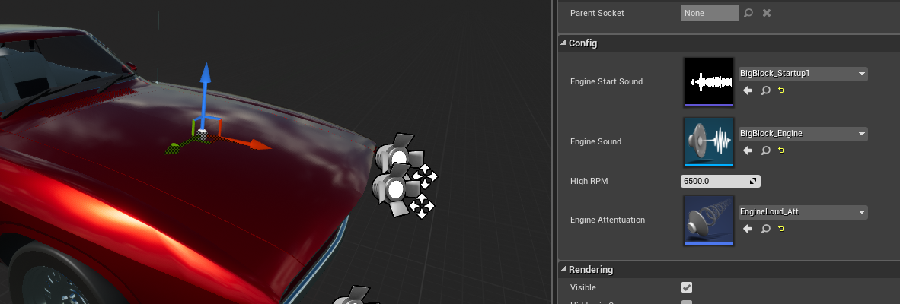
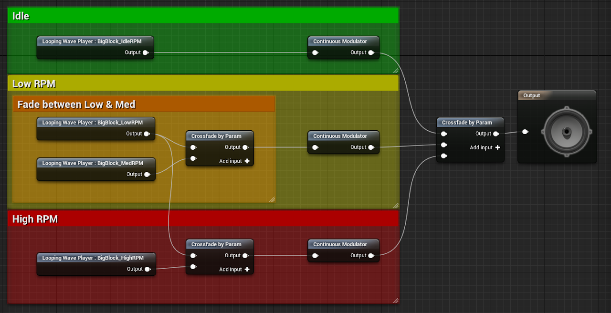

# Engine Audio

`AVS_EngineAudio` plays an engine sound that follows the vehicle's RPM and throttle, and a start sound when the engine starts. This page adds engine sound to the car from the [Quick Start](https://overtorque-creations.com/Dev/Docs/#AVS/Getting_Started/Quick_Start.md).

The component is optional. Every setting is listed in [Component Settings](https://overtorque-creations.com/Dev/Docs/#AVS/Reference/Component_Settings.md).

## How Engine Audio Works

The component plays **Engine Sound** in a loop. Every frame, it sends the sound two parameters:

- **RPM**: the vehicle's RPM, scaled so that **High RPM** arrives as `8000`.
- **Throttle**: the vehicle's throttle, from `0` to `1`.

Your Sound Cue or MetaSound uses those two parameters to change the sound. RPM comes from the gear table's **Low RPM** and **High RPM**. See [Engine and Transmission](https://overtorque-creations.com/Dev/Docs/#AVS/Configuration/Engine_And_Transmission.md).

## Adding Engine Sound

<!-- side-by-side:40 -->
1. Add an `AVS_EngineAudio` component to the car, and place it where the engine sound should come from, such as under the hood.
2. Set **Engine Sound** to a looping Sound Cue or MetaSound.
3. Set **Engine Start Sound** to a sound to play when the engine starts. It is optional.
4. Set **High RPM** to the highest RPM the car reaches. The default is `7000`.
<!-- split -->

<!-- /side-by-side -->

**Engine Attenuation** controls how the sound fades with distance. It uses the plugin's `Engine_Att` by default.

## Building the Engine Sound

<!-- side-by-side:50 -->
The example Sound Cue has idle, low RPM and high RPM loops. It crossfades between them with the **RPM** parameter, then changes their volume and pitch with **Throttle**.

The demo project includes several engine sounds to learn from. Building Sound Cues and MetaSounds is covered in Unreal's own documentation.

A sound that ignores the two parameters plays unchanged.
<!-- split -->

<!-- /side-by-side -->

## When the Sounds Play

The engine loop starts when the vehicle spawns, whether or not the engine is running. While the engine is off, the vehicle's RPM falls to `0`, and so does the **RPM** parameter.

The start sound plays when the engine starts, at the beginning of the vehicle's **Ignition Time**. It fades out from a quarter of the way through to its end.

`StopSound()` stops the engine loop.

While the vehicle is passive, the component stops sending new RPM and throttle values. On a dedicated server, the component removes itself.

## Next Steps

- [Engine and Transmission](https://overtorque-creations.com/Dev/Docs/#AVS/Configuration/Engine_And_Transmission.md): RPM and the gear table.
- [Exhaust](https://overtorque-creations.com/Dev/Docs/#AVS/Components/Exhaust.md): exhaust smoke driven by RPM and throttle.
