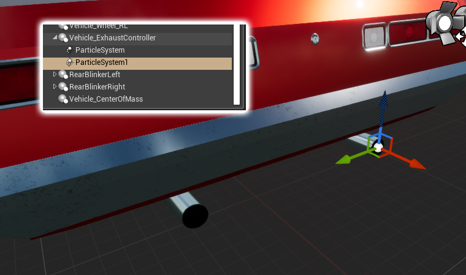

# Exhaust

`AVS_ExhaustController` drives exhaust particles from the vehicle's engine state.

## Setting up Exhaust Smoke

<!-- side-by-side:40 -->
The Vehicle System also includes another optional component called `AVS_ExhaustController` for controlling exhaust particles. It simply drives 2 parameters _SmokeVelocity_ and _SmokeSize_ from any particle system that is attached to it. There is an included Exhaust particle within the plugin, which is also a good starting point to make your own.
<!-- split -->

<!-- /side-by-side -->

## Exhaust Particle Parameters

The controller sets two vector parameters on every Cascade particle system component beneath it. Only X is used:

- **SmokeVelocity** X goes from `40` to `150` as RPM rises from `0` to `10000`.
- **SmokeSize** X goes from `30` to `80` as throttle goes from `0` to `1`.

Any Cascade particle system reading those two names will work. Niagara systems are not driven by the controller.

The particles are active while the engine is running and the vehicle is slower than `40` in your **Speed Units**, and inactive otherwise.
