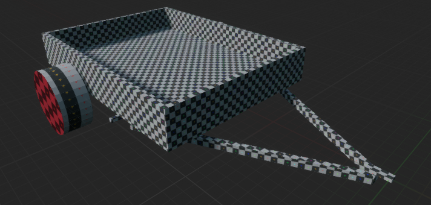
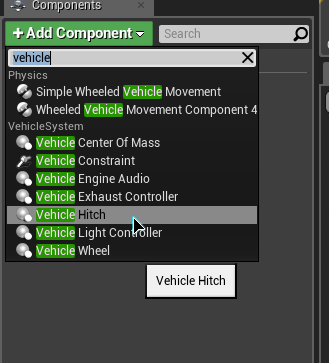
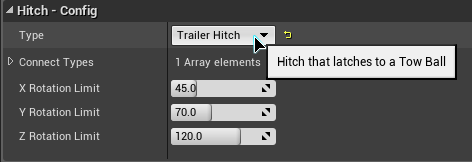
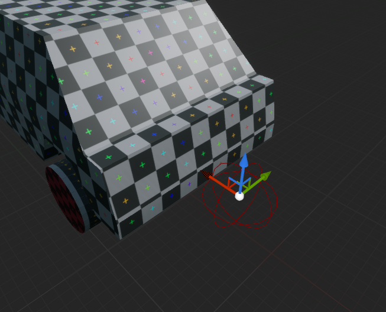
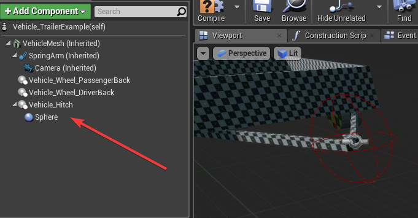
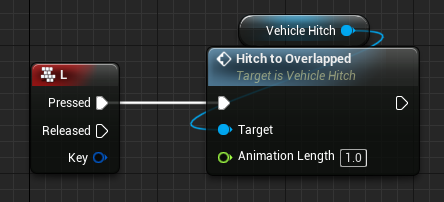
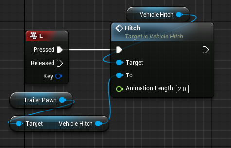

# Hitch / Trailers

How to tow a trailer. This page hitches the trailer included with the plugin to the car from the [Quick Start](https://overtorque-creations.com/Dev/Docs/#AVS/Getting_Started/Quick_Start.md).

Every hitch setting, function and event is listed in [Component Settings](https://overtorque-creations.com/Dev/Docs/#AVS/Reference/Component_Settings.md).

## How Trailers Work

A trailer is an ordinary AVS vehicle with a hitch on it. It has wheels, brakes, steering and even an engine, like any other AVS vehicle. A trailer could be driven by a second player, or have its own powered axle.

Hitching uses two `AVS_Hitch` components, one on each vehicle:

- A **Tow Hitch** on the towing vehicle, like the ball on a real tow bar.
- A **Trailer Hitch** on the trailer, like the coupler on a real trailer tongue.

When they connect, the trailer is pulled to the tow hitch, then held there by a physics constraint that lets it turn.

## Step 1: Create the Trailer

<!-- side-by-side:57 -->
Create a vehicle Blueprint for the trailer, the same way as the car in the Quick Start. Give it wheels, and leave **Is Driving Wheel** and **Is Steerable Wheel** off on all of them.

The plugin includes a trailer mesh and wheel you can use.
<!-- split -->

<!-- /side-by-side -->

## Step 2: Add the Trailer Hitch

<!-- side-by-side:57 -->
1. Add an `AVS_Hitch` component to the trailer.
2. Move it to the point the trailer is towed from, at the front of the tongue. On the included trailer mesh, that point is at zero, so the hitch does not need moving.
3. Make sure its X axis (red) points forward along the trailer.
4. Set **Hitch Type** to `Trailer Hitch`.
<!-- split -->

<!-- /side-by-side -->

<!-- side-by-side:57 -->
**Hitch Type** is the only setting the trailer hitch needs. Its rotation limits are not used; the tow hitch's limits apply.
<!-- split -->

<!-- /side-by-side -->

## Step 3: Add the Tow Hitch

<!-- side-by-side:57 -->
1. Open the car and add an `AVS_Hitch` component.
2. Leave **Hitch Type** as `Tow Hitch`.
3. Move it to where the tow ball would be, behind the rear bumper.
4. Make sure its X axis (red) points forward along the car.
<!-- split -->

<!-- /side-by-side -->

## Step 4: Add Overlap Shapes

<!-- side-by-side:48 -->
To hitch whenever the two hitches are close, add a collision shape (sphere, box or capsule) directly under each hitch. The shapes mark the area where hitching is allowed. Hitching happens when the two shapes overlap.

The shapes are only needed for `HitchToOverlapped` in the next step.
<!-- split -->

<!-- /side-by-side -->

## Step 5: Hitch on a Key Press

In the car's Blueprint, add a key event and call one of the two hitch functions on the tow hitch:

<!-- side-by-side:50 -->
**Hitch To Overlapped**

Hitches to a nearby trailer whose overlap shape is touching the tow hitch's.

<!-- split -->
**Hitch**

Hitches to the trailer hitch you pass in **To**, wherever it is. The trailer is pulled to the tow hitch, however far away it is.

<!-- /side-by-side -->

**Animation Length** is how many seconds the trailer takes to be pulled into place. `Hitch` uses `2` by default. At `0`, the constraint is applied immediately, without the trailer being pulled into place first.

To release the trailer, call `Unhitch` on either hitch, or `UnhitchAll` on the car.

In multiplayer, call these on the client that owns the car, or on the server. Calls from anywhere else are ignored.

## Connect Types

Two hitches can only connect if they share an entry in **Connect Types**. Every hitch starts with `Standard`.

Different names keep different hitch styles apart. A trailer with both `Standard` and `Semi` can hitch to a tow hitch with either one.

`HitchToOverlapped` only tries the first unhitched trailer hitch it finds. If that one does not share a connect type, nothing happens, even if another trailer hitch in range would.

## Hitch Rotation Limits

On the tow hitch, three settings limit how far the trailer can turn at the hitch, in degrees each way:

- **X Rotation Limit** (`45`): roll.
- **Y Rotation Limit** (`70`): pitch, such as going over a crest.
- **Z Rotation Limit** (`120`): yaw, turning side to side.

`180` leaves that axis free.

## Braking and Steering the Trailer with the Car

A trailer is a full vehicle, and its inputs stay at zero unless something sets them. `SetInputHost` makes it copy the car's throttle, brake, steering and handbrake, 25 times a second:

1. Bind to the tow hitch's **Hitched** event, and call `SetInputHost` on the trailer with the car.
2. Bind to **Unhitched**, and call `SetInputHost` with nothing to stop copying. Then set the trailer's brake and handbrake as needed. Clearing the host does not reset them.

With a host set, the trailer's braking wheels brake with the car, and its steerable wheels follow the car's steering. A powered trailer's driving wheels pull under the same throttle, if the trailer's engine is running.

## Hitch Events

- **Hitched** fires when a connection is made, with the tow hitch and the trailer hitch.
- **Unhitched** fires when the connection is released.
- **Hitched To Destroyed** fires when the hitch on the other end is destroyed, for example with its vehicle. The hitch then unhitches itself.

`GetIsHitched` returns whether a hitch is connected. `GetHitchedTrailer` returns the trailer, and `GetHitchedVehicle` the towing vehicle.

## Trailer Chains

A trailer can tow another trailer: give the first trailer a tow hitch as well. This works in single player. It is untested in multiplayer and likely does not work there.

## Fixing Hitch Problems

### Hitch To Overlapped Does Nothing

Check that:

1. It is called on the tow hitch.
2. Each hitch has its collision shape directly under it.
3. The shapes overlap when the vehicles are close.
4. The two hitches share a **Connect Types** entry.

## Next Steps

- [Networking](https://overtorque-creations.com/Dev/Docs/#AVS/Advanced/Networking.md): how trailers replicate.
- [Component Settings](https://overtorque-creations.com/Dev/Docs/#AVS/Reference/Component_Settings.md): every hitch setting and function.
