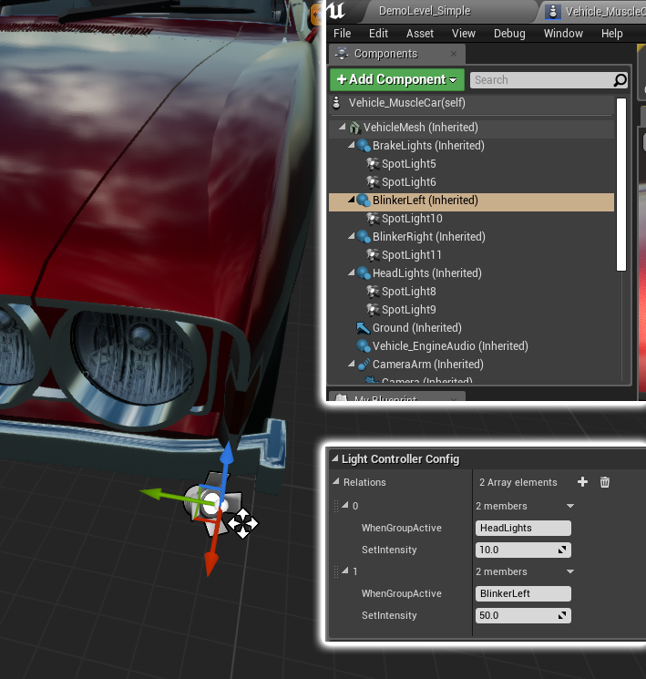
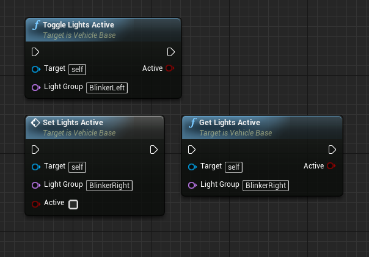
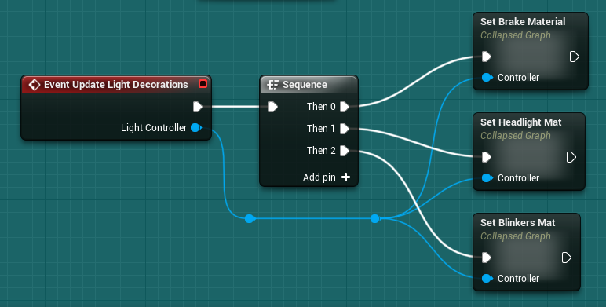
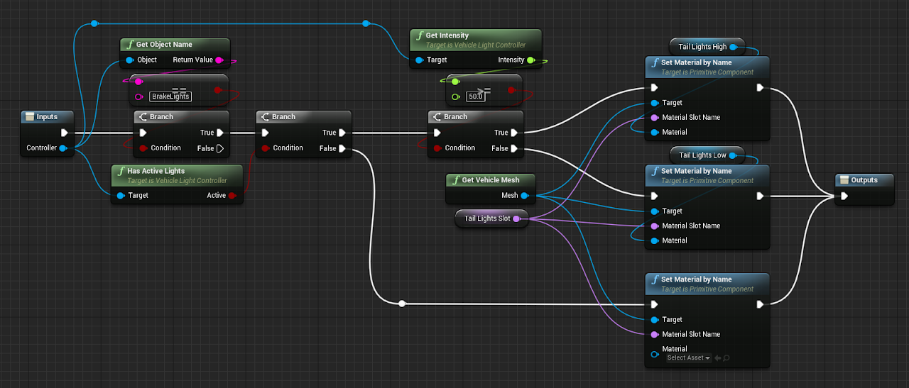

# Vehicle Lights

How to set up headlights, brake lights and blinkers on a vehicle. The example is the muscle car from the demo project, which has headlights, brake lights and two blinkers.

Every light setting and function is listed in [Component Settings](https://overtorque-creations.com/Dev/Docs/#AVS/Reference/Component_Settings.md).

## How Vehicle Lights Work

Three things work together:

- **Light groups** are names, such as `HeadLights` or `BlinkerLeft`, that the vehicle keeps a list of. Each group is either on or off. Groups have no settings and do not need to be created first. A group exists as soon as you turn it on.
- **Light controllers** are `AVS_LightController` components. Every light component attached under a controller is driven by it.
- **Relations** are rules on each controller, such as "while `HeadLights` is on, set my lights to an intensity of `10`".

Your code turns groups on and off, then calls `UpdateLights`. `UpdateLights` goes through every light controller, checks its relations against the groups that are on, and sets the intensity of the controller's lights.

A light set to an intensity of `0` is also hidden. At the start, every group is off, and the lights attached directly under each controller are hidden.

## The Example Vehicle

<!-- side-by-side:50 -->

<!-- split -->
The muscle car has four light controllers, one for each set of lights: `HeadLights`, `BrakeLights`, `BlinkerLeft` and `BlinkerRight`.

The `BlinkerLeft` controller has two relations:

1. While `HeadLights` is on, intensity `10`.
2. While `BlinkerLeft` is on, intensity `50`.

With the headlights on, the left blinker glows dimly at `10`. When the `BlinkerLeft` group turns on, the blinker brightens to `50`. When it turns off again, the blinker drops back to `10`, or to `0` if the headlights are off.

Turning `BlinkerLeft` on and off on a timer makes the blinker flash, while still glowing dimly between flashes with the headlights on, like a real car.
<!-- /side-by-side -->

## Adding a Light Controller

1. Add an `AVS_LightController` component to the vehicle, and name it after the lights it holds, such as `BlinkerLeft`.
2. Attach one or more light components (point, spot or rect lights) directly under it.
3. Select the controller, and under **Advanced Vehicle System → Lights**, add entries to **Relations**.
4. In each entry, set **When Group Active** to a group name and **Set Intensity** to the intensity for the lights while that group is on.

Group names must match exactly between the relations and your code.

> Due to a bug, Vehicles saved in AVS 1.5.0 to 1.5.2 lost their **Relations** values. Re-enter them in 1.5.3 or later.

## Which Relation Wins

When more than one of a controller's relations has its group on, the **last** matching relation in the list sets the intensity.

In the example, `BlinkerLeft` is listed after `HeadLights`. With both on, the blinker shows `50`. If the order were swapped, the headlights' `10` would win and the blinker would never brighten.

Order each controller's relations from lowest to highest priority.

If none of a controller's relations has its group on, its lights are set to `0` and hidden.

## Turning Light Groups On and Off

<!-- side-by-side:41 -->

<!-- split -->
These functions are on the vehicle:

- `SetLightsActive(Group, Active)` turns a group on or off.
- `ToggleLightsActive(Group)` flips a group, and returns whether it is now on.
- `GetLightsActive(Group)` returns whether a group is on.
- `UpdateLights()` applies the groups to the lights.

Changing a group does nothing to the lights until `UpdateLights` runs. Change all the groups you need, then call `UpdateLights` once.
<!-- /side-by-side -->

`UpdateLights` is protected, so it can only be called from inside the vehicle's own Blueprint or C++ class. To change lights from another actor, such as a player controller, add a function to your vehicle that sets the groups and calls `UpdateLights`, and call that.

## Brake Lights

AVS calls `UpdateLights` itself whenever the brake is pressed or released, but it does not turn any group on or off. To make brake lights follow the brake, override **UpdateLights** in your vehicle:

1. In your vehicle Blueprint, override **UpdateLights** from the **Functions** list. It appears as an event in the event graph.
2. From the event, call `SetLightsActive` with your brake group (for example `BrakeLights`), and `GetBrakeApplied` as **Active**.
3. Right-click the event and choose **Add Call to Parent Function**, and connect the parent call after `SetLightsActive`. The parent applies the groups to the lights.

Without the parent call, no lights change at all, including the headlights and blinkers.

The example's `BrakeLights` controller can have two relations: `HeadLights` at a low intensity, so the tail lights glow with the headlights on, then `BrakeLights` at a high intensity.

## Light Materials and Sounds

After `UpdateLights` sets a controller's intensity, the vehicle fires **UpdateLightDecorations** with that controller. It fires once per controller, every time `UpdateLights` runs.

Use it for anything that should change with the lights besides the light components themselves, such as emissive materials on the vehicle mesh, or a blinker click sound.

<!-- side-by-side:50 -->

<!-- split -->
Two functions on the controller tell you its state:

- `GetIntensity()` returns the intensity it was just set to.
- `HasActiveLights()` returns whether that intensity is above `0`.

Compare the event's controller with your own controller components to tell which one is updating.
<!-- /side-by-side -->

## Lights in Multiplayer

Light groups are not replicated. Each machine keeps its own list, so a group turned on by the driver's client is only on for that client.

To show lights on every machine, replicate your own variable, such as a `bHeadlightsOn` boolean with a RepNotify, and set the group and call `UpdateLights` in the RepNotify.

Brake lights set up as above work on every machine without this, because the brake input is replicated and every machine runs the brake check.

## Setting Light Intensity Directly

`Illuminate(Intensity)` on a light controller sets its lights to an intensity without using groups.

The next `UpdateLights` replaces it, and AVS calls `UpdateLights` every time the brake is pressed or released. To keep a value set with `Illuminate`, set it again in **UpdateLightDecorations**.

## Troubleshooting

Check, in this order:
1. `UpdateLights` is called after the groups change.
2. If **UpdateLights** is overridden, it calls the parent.
3. The group name in **When Group Active** matches the name in your code.
4. The light components are attached under the light controller.

## Next Steps

- [Component Settings](https://overtorque-creations.com/Dev/Docs/#AVS/Reference/Component_Settings.md): every light controller setting and function.
- [Engine Audio](https://overtorque-creations.com/Dev/Docs/#AVS/Components/Engine_Audio.md): the engine sound.
