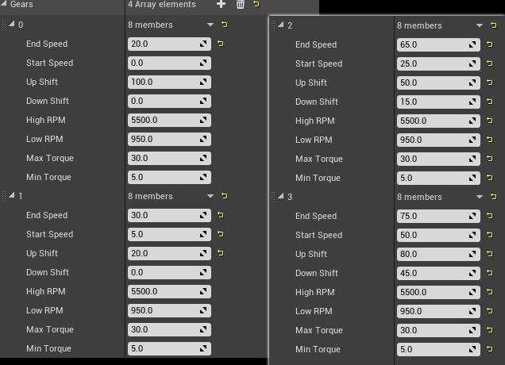

# Engine and Transmission

How AVS turns throttle into drive torque, and how to build a gear table. The example is the three-gear car from the [Quick Start](https://overtorque-creations.com/Dev/Docs/#AVS/Getting_Started/Quick_Start.md).

Every engine and transmission setting is listed in [Vehicle Settings](https://overtorque-creations.com/Dev/Docs/#AVS/Reference/Vehicle_Settings.md).


## How the Engine and Transmission Work

AVS does not simulate an engine. Drive torque comes from a table of gears.

Each gear covers a range of speeds. At its **Start Speed** the gear gives **Max Torque**, and at its **End Speed** it gives **Min Torque**. Between the two, torque changes evenly from one to the other. The throttle then scales that torque.

Every driving wheel receives this torque. Two driving wheels get twice the total torque of one.

RPM is not part of the calculation. Each gear's **Low RPM** and **High RPM** set the RPM shown across its speed range, for engine audio and the HUD.


## Choosing a Transmission Mode

<!-- side-by-side:50 -->
**Automatic** (the default)

**Automatic Transmission** on. AVS changes gears at each gear's **Up Shift** and **Down Shift** speeds.

The player moves the shifter between Park, Reverse, Neutral and Drive.
<!-- split -->
**Fully automatic**

**Automatic Shifter Positon** on as well. AVS moves the shifter too.

Pressing throttle from a stop selects Drive. Pressing brake from a stop selects Reverse. Releasing both at a stop selects Park.
<!-- /side-by-side -->

Fully automatic needs throttle and brake on one input axis, sent with `SetThrottleAndBrakeInput`. The Quick Start covers the input setup.

For a manual transmission, turn **Automatic Transmission** off and select gears with `SetManualGear`. It only selects forward gears.

The example car uses the automatic mode.


## Building the Gear Table

<!-- side-by-side:57 -->
1. Set **Speed Units** under **Advanced Vehicle System → General** first. Every speed in the gear table uses it, and changing it later does not convert them.
2. Open **Advanced Vehicle System → Transmission** and expand **Gears**.
3. Gear `0` is reverse. Every gear after it is a forward gear. Add gears until there are four.
4. Enter the values from the table below.
<!-- split -->

<!-- /side-by-side -->

| | Gear 0 (reverse) | Gear 1 | Gear 2 | Gear 3 |
|---|---|---|---|---|
| End Speed | 20.0 | 30.0 | 65.0 | 75.0 |
| Start Speed | 0.0 | 5.0 | 25.0 | 50.0 |
| Up Shift | 100.0 | 20.0 | 50.0 | 80.0 |
| Down Shift | 0.0 | 0.0 | 15.0 | 45.0 |
| High RPM | 5500.0 | 5500.0 | 5500.0 | 5500.0 |
| Low RPM | 950.0 | 950.0 | 950.0 | 950.0 |
| Max Torque | 30.0 | 30.0 | 30.0 | 30.0 |
| Min Torque | 5.0 | 5.0 | 5.0 | 5.0 |

Each gear's speed range overlaps the next one. Gear 1 runs from 5 to 30, and gear 2 starts at 25.

Gear 1 changes up at 20, before its **End Speed**. Gear 2 changes back down at 15, below gear 1's **Up Shift**. With **Down Shift** above the previous gear's **Up Shift**, the transmission changes up, finds itself below the new gear's **Down Shift**, and changes straight back down.

Reverse's **Up Shift** and **Down Shift** have no effect.

Torque is in hectonewton meters (hNm). `30` is 3000 Nm at each driving wheel.


## Starting the Engine and Shifting into Drive

A vehicle spawns with the engine off and the shifter in Park. It does not move until both change.

- **Start With Engine Running** starts the engine on spawn. In code, `StartEngine` starts it.
- `SetShifterInput(Drive)` puts the shifter in Drive. `MoveShifterInput` moves it one position, toward Park when **MoveUp** is true and toward Drive when it is false.

The engine runs after **Ignition Time** (`0.5` s). An Engine Audio component plays its start sound during that time.

In Park, the driving wheels are locked.


## Tuning Speed and Acceleration

**Max Torque** sets how hard a gear pulls at the bottom of its range. Raise it for faster acceleration.

**Min Torque** sets how much pull is left at the top of the range. If it is too low to overcome drag, the vehicle never reaches the gear's **End Speed**.

The last gear's **End Speed** is not a hard limit. Past **End Speed**, torque starts again from **Max Torque** and falls to `0` over a further quarter of the gear's range. The example's gear 3 runs from 50 to 75, so it still pulls until about 81.

Torque applies to every driving wheel, so an all wheel drive version of the example has twice the drive torque of a rear wheel drive one. To keep the total the same as driving wheels change, see [Distributing Gear Torque Across Driving Wheels](https://overtorque-creations.com/Dev/Docs/#AVS/Guides/Torque_Distribution.md).


## Shifter Position and Current Gear

The shifter is Park, Reverse, Neutral or Drive. The gear is the entry in **Gears** that is supplying torque.

A gear change takes **Gear Switch Time** (`0.5` s). During it, no gear supplies torque. **Zero Throttle While Shifting** also cuts the throttle during it.

`GetSelectedGear` returns the gear the transmission wants. `GetCurrentGear` returns the gear actually engaged, and `-1` during a gear change or out of gear. A gear display should read `GetCurrentGear`.

**GearChanged** fires when a gear change completes, with the old and new gear index. **ShifterChanged** fires when the shifter is set. Both are Blueprint events and can be overridden in C++.


## RPM

In gear, RPM follows the driving wheels' speed across the gear's range, from **Low RPM** to **High RPM**. Throttle adds up to 1000 RPM either way, kept within that range.

With no gear engaged (Park, Neutral, or during a gear change), RPM goes from **Idle RPM** (`1000`) with no throttle to **Idle Max RPM** (`7500`) at full throttle.

`GetEngineRPM` returns the current RPM. The [Engine Audio](https://overtorque-creations.com/Dev/Docs/#AVS/Components/Engine_Audio.md) component sends it to the engine sound.


## Changing the Gear Table at Runtime

`SetGearArray` replaces the whole table. `SetGearItem` replaces one gear by index, and adds entries if the index is past the end.

Both apply to the gear currently engaged straight away. In a forward gear, neither causes a gear change. In reverse, both reset the selected gear to `1`, so the transmission changes back into reverse, taking **Gear Switch Time**.

Editing the **Gears** array directly takes effect at the next gear change, because AVS works from a copy of the engaged gear.

```cpp
TArray<FVehicleGear> NewGears;

FVehicleGear Reverse;
Reverse.StartSpeed = 0.0f;
Reverse.EndSpeed   = 20.0f;
Reverse.LowRPM     = 950.0f;
Reverse.HighRPM    = 5500.0f;
Reverse.MaxTorque  = 30.0f;  // hNm at each driving wheel
Reverse.MinTorque  = 5.0f;
NewGears.Add(Reverse);       // Gear 0 is reverse

FVehicleGear First;
First.StartSpeed = 5.0f;
First.EndSpeed   = 30.0f;
First.UpShift    = 20.0f;
First.DownShift  = 0.0f;
First.LowRPM     = 950.0f;
First.HighRPM    = 5500.0f;
First.MaxTorque  = 30.0f;
First.MinTorque  = 5.0f;
NewGears.Add(First);

Vehicle->SetGearArray(NewGears);
```


## Fixing Engine and Transmission Problems

### Vehicle Does Not Move

Check that the engine is running and the shifter is in Drive. A vehicle spawns with the engine off and in Park. Then check that at least one wheel has **Is Driving Wheel** on.

### Vehicle Never Reaches a Gear's End Speed

Raise that gear's **Min Torque**.

### Transmission Changes Up and Straight Back Down

Set the gear's **Down Shift** below the previous gear's **Up Shift**.


## Next Steps

- [Steering](https://overtorque-creations.com/Dev/Docs/#AVS/Configuration/Steering.md): steering speed and the falloff curve.
- [Engine Audio](https://overtorque-creations.com/Dev/Docs/#AVS/Components/Engine_Audio.md): an engine sound driven by RPM and throttle.
- [Vehicle Settings](https://overtorque-creations.com/Dev/Docs/#AVS/Reference/Vehicle_Settings.md): every engine and transmission setting.
