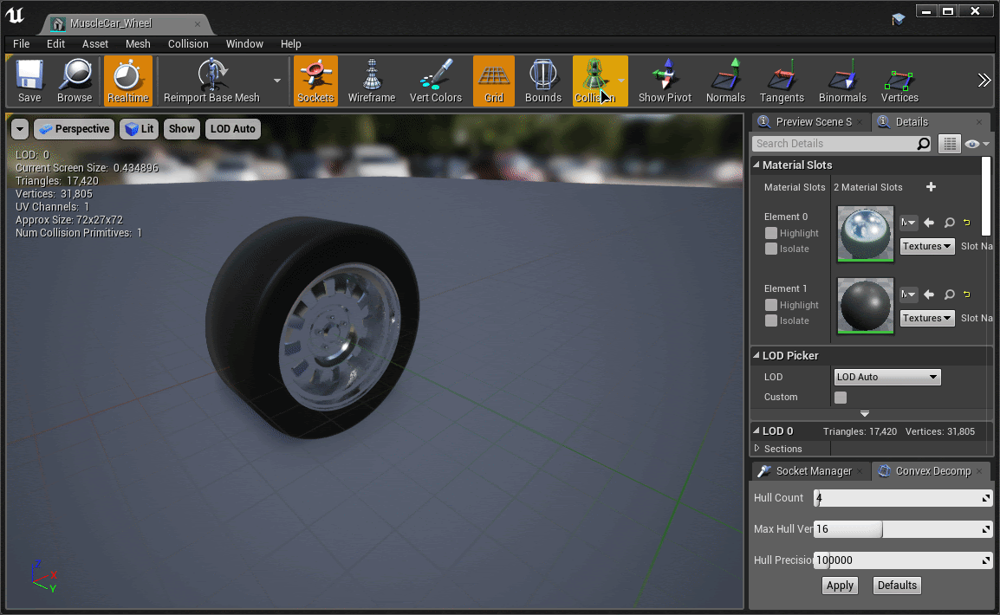
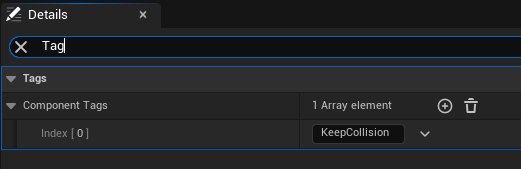
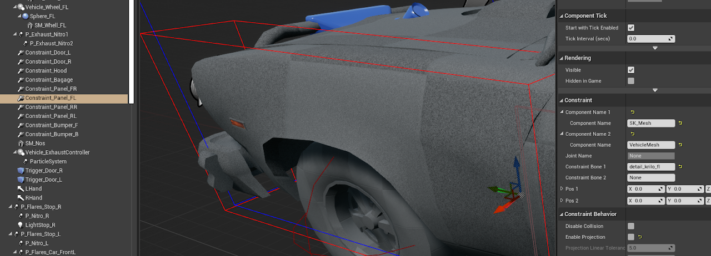
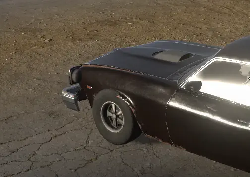

# Important Information

Behavior to know before going far into a project. Each of these has caused confusion that is hard to trace back later.

## Physics Wheels Need Sphere Collision

<!-- side-by-side:48 -->
A wheel in physics mode rolls on its wheel mesh's collision. Unreal's Chaos physics has no true cylinder shape, and a convex shape made to look like a cylinder is not perfectly round. At speed, it makes the wheel bounce and shake.

Give physics mode wheels a simple sphere collision. Other shapes are allowed, and only behave well at low speed.

Raycast wheels do not use the wheel mesh's collision, so any shape works for them. It only matters when a raycast wheel is detached and becomes a loose physics body.
<!-- split -->

<!-- /side-by-side -->

## Blueprint Events No Longer Need a Parent Call

In AVS 1.4 and earlier, several Blueprint events needed a call to the parent function, or the vehicle did not work.

AVS 1.5 is written in C++, and its code runs whether or not your event calls the parent. Construction Script, BeginPlay, Destroyed, OnPossessed and Unpossessed all work without it.

A guide that tells you to add a parent call was written for 1.4 or earlier. Parent calls left over in an older project do no harm.

## Skeletal Mesh Collision Is Turned Off

<!-- side-by-side:57 -->
When the vehicle is constructed, AVS turns off collision on every skeletal mesh component on it. Skeletal meshes cannot weld to the vehicle's physics body, and their collision can make the vehicle's physics unstable.

To keep collision on one skeletal mesh, add the tag `KeepCollision` to its **Component Tags**.

To turn this off for the whole vehicle, turn off **Disable Skeletal Collisions** under **Advanced Vehicle System → Physics**.
<!-- split -->

<!-- /side-by-side -->

For collision that should affect the vehicle, see [Attaching Objects](https://overtorque-creations.com/Dev/Docs/#AVS/Components/Attaching_Objects.md).

## Keep Physics Constraints Out of Physics Assets

<!-- side-by-side:48 -->
If a skeletal mesh is part of your vehicle and its parts need physics constraints, do not put the constraints in the skeletal mesh's Physics Asset. This matters most for constraints that rely on the skeletal mesh's root body.

Create the constraints in the vehicle Blueprint and connect them to `VehicleMesh`, the AVS root component. From there they reference the true root of the simulation.
<!-- split -->

<!-- /side-by-side -->

<!-- side-by-side:52 -->

<!-- split -->
Constraints in a skeletal mesh's Physics Asset can receive out-of-date transforms. The cause is how Unreal updates transforms for components that are not welded to the root, and the skeletal mesh is not welded to `VehicleMesh`. It is worst when simulated and non-simulated bodies are mixed.

The physics becomes unstable, and the constrained parts stutter or jitter violently. The clip shows the result.
<!-- /side-by-side -->

## Tick Stops When a Vehicle Parks

When a vehicle comes to rest, AVS puts it in passive mode to save work. In passive mode, the vehicle's Tick event stops, so Blueprint logic on Tick stops running while the vehicle is parked.

Put logic that must keep running on **AVS_AlwaysTick** instead.

A vehicle possessed by a player or AI never goes passive. A vehicle moved without being possessed, such as by a sequencer, can. See [Tick and Performance](https://overtorque-creations.com/Dev/Docs/#AVS/Advanced/Tick_And_Performance.md).

## Platform Support

AVS supports every platform Unreal supports.

The plugin's deny list names VisionOS only because FAB requires the list to name at least one platform. To build for VisionOS, remove it from `PlatformDenyList` in `VehicleSystemPlugin.uplugin`.

Older guidance said iOS had to be added to an allow list. That is no longer needed.

## Installing the Plugin to a Project

The launcher installs AVS to the engine. To keep it inside a project instead, for source control or for a team without the launcher:

1. Install AVS to an engine through the launcher.
2. Copy `...\UE_5.x\Engine\Plugins\Marketplace\VehicleSystemPlugin` to `YourProject\Plugins\VehicleSystemPlugin`.

The project may recompile the plugin the first time it opens.
