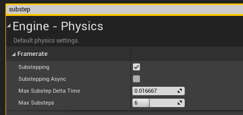
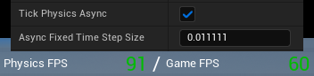
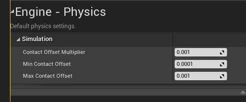
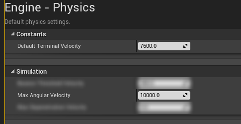

# Recommended Project Settings

Changes to Unreal's physics settings that make AVS vehicles more stable. None of them are required. All are under **Project Settings → Physics**.

The physics tick settings help every vehicle. The contact offset and velocity settings only matter for physics mode wheels.


## Physics Tick Settings

By default, Unreal runs physics once per frame, so at a low frame rate each physics step covers a long time and vehicles become unstable. Substepping or async physics keeps the physics step short whatever the frame rate. Choose one.

### Option 1: Substepping

<!-- side-by-side:41 -->

<!-- split -->
Substepping splits a slow frame into several physics steps.

Above the target rate, physics runs once per frame, matching the game. Below it, physics runs several steps per frame to get as close to the target as **Max Substeps** allows.

Turn on **Substepping**, then set **Max Substep Delta Time** and **Max Substeps** from the table.
<!-- /side-by-side -->

| Max Substep Delta Time | Max Substeps | Physics rate | Stable at |
|---|---|---|---|
| `0.016667` | `6` | 60 FPS | 15 and 30 FPS |
| `0.013000` | `6` | 90 FPS | 15, 30 and 60 FPS |
| `0.009400` | `8` | 120 FPS | 15, 30, 60 and 90 FPS |

### Option 2: Async Physics

<!-- side-by-side:48 -->
Async physics runs physics on its own thread at a fixed rate, separate from the frame rate. The results are interpolated for display. It gives the most consistent physics.

Turn on **Tick Physics Async**, then set **Async Fixed Time Step Size** from the table.
<!-- split -->

<!-- /side-by-side -->

| Async Fixed Time Step Size | Physics rate |
|---|---|
| `0.033333` | 30 FPS |
| `0.016667` | 60 FPS |
| `0.011111` | 90 FPS |
| `0.008333` | 120 FPS |


## Contact Offsets

<!-- side-by-side:41 -->

<!-- split -->
Unreal keeps a small gap between colliding physics bodies. For a physics mode wheel, this gap makes the wheel bounce when it rolls from one surface onto another, even when the two are perfectly level. The faster the vehicle, the bigger the bounce.

Set **Contact Offset Multiplier**, **Min Contact Offset** and **Max Contact Offset** to the lowest values Unreal allows, as in the image.

Raycast wheels are not affected.
<!-- /side-by-side -->


## Terminal Velocity and Max Angular Velocity

<!-- side-by-side:41 -->

<!-- split -->
Unreal limits how fast physics bodies can move and spin. A physics mode wheel spinning at the limit cannot get any faster, which caps the vehicle's top speed.

| Setting | Value |
|---|---|
| **Default Terminal Velocity** | `7600` cm/s (about 170 mph) |
| **Max Angular Velocity** | `10000` deg/s |
<!-- /side-by-side -->

A wheel's top surface speed is its spin limit times its radius:

```text
Speed (cm/s) = Max Angular Velocity (deg/s) × (π / 180) × Wheel Radius (cm)
```

A 35 cm wheel at `10000` deg/s reaches about 6109 cm/s, or about 137 mph. For a faster vehicle, or bigger wheels, raise **Max Angular Velocity** until the wheels never reach it.

The vehicle body has its own spin limit, **Vehicle Max Angular Velocity**, set on the vehicle. See [Physics](https://overtorque-creations.com/Dev/Docs/#AVS/Configuration/Physics.md).


## Niagara

AVS needs the **Niagara** plugin, which is on by default in Unreal. If you turned it off, turn it back on.


## Next Steps

- [Quick Start](https://overtorque-creations.com/Dev/Docs/#AVS/Getting_Started/Quick_Start.md): build a drivable car.
- [Important Information](https://overtorque-creations.com/Dev/Docs/#AVS/Getting_Started/Important_Information.md): behavior to know before going further.
