# Vehicle Quick Start Guide

This guide builds a drivable rear wheel drive car from an empty project. Other pages in these docs use this car as their example.

Two ready-made projects are available:

- The [AVS Template v3](https://drive.google.com/file/d/1PniU5KLitjbEVJ8-yfBVYLvvDHCoCT3n/view?usp=sharing) is a small, minimal project to get you started. It needs Unreal 5.7 or later and AVS 1.5 or later.
- The [playable demo](https://overtorque-creations.com/Dev/AdvancedVehicleSystem/Demo/) is a much larger project that shows many of AVS's features. Its page also links to the demo's source project.

Following this guide once is still the quickest way to learn how the parts fit together.

## Before You Start

You need:

- The Advanced Vehicle System plugin, enabled in your project. The [FAB listing](https://www.fab.com/listings/e1457ad1-297b-4a70-aecb-5c6716d9494f) lists the supported engine versions.
- A static mesh for the car body and one for a wheel. The plugin includes a basic body and wheel you can use. For your own meshes, see [Preparing Vehicle Meshes](https://overtorque-creations.com/Dev/Docs/#AVS/Getting_Started/Preparing_Vehicle_Meshes.md).
- A basic understanding of Unreal Engine. Some steps expect you to create Blueprints and input mappings without step-by-step help.

To see the plugin's content in the content browser, turn on **Show Engine Content** if the plugin is installed to the engine, or **Show Plugin Content** if it is installed to the project.

Applying the [recommended project settings](https://overtorque-creations.com/Dev/Docs/#AVS/Getting_Started/Project_Settings.md) first is optional. They make physics more stable.

> Using AVS 1.4 or earlier? Use the [Legacy documentation](https://overtorque-creations.com/Dev/Docs/#AVS_Legacy/README.md). A lot changed in 1.5.

## Step 1: Create the Inputs

<!-- side-by-side:41 -->
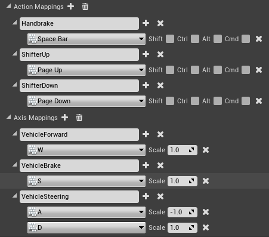
<!-- split -->
Create these inputs, with Enhanced Input or the older input mappings:

- **VehicleForward**: an axis from `0` to `1`, for throttle.
- **VehicleBrake**: an axis from `0` to `1`, for the brake.
- **VehicleSteering**: an axis from `-1` to `1`.
- **Handbrake**: a button.
- **ShifterUp** and **ShifterDown**: buttons.
<!-- /side-by-side -->

## Step 2: Create a Base Vehicle Blueprint

A base Blueprint holds what every vehicle in your project shares, such as the camera and the input handling. Each actual vehicle is a child of it.

<!-- side-by-side:50 -->
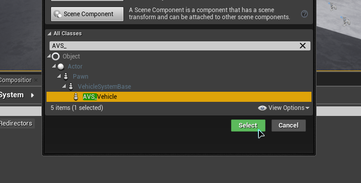
<!-- split -->
1. Create a new Blueprint class with `AVS_Vehicle` as its parent. Name it after your project, such as `MyProject_Vehicle`.
2. Open it, and add a **Spring Arm** component.
3. Add a **Camera** component under the spring arm.
4. Rotate the spring arm a little to the side, so you can see the wheels while you drive.
<!-- /side-by-side -->

This camera is fixed. For look input, lag and G-force movement, see [Camera Pivot](https://overtorque-creations.com/Dev/Docs/#AVS/Components/Camera_Pivot.md) once the car drives.

## Step 3: Start the Engine on BeginPlay

A vehicle spawns with the engine off and the shifter in Park, so it does not move. To drive straight away, start the engine and shift into Drive when the game begins.

<!-- side-by-side:48 -->
In the base Blueprint's event graph:

1. From **Event BeginPlay**, call **Start Engine**.
2. Then call **Set Shifter Input** with **Drive**.
<!-- split -->
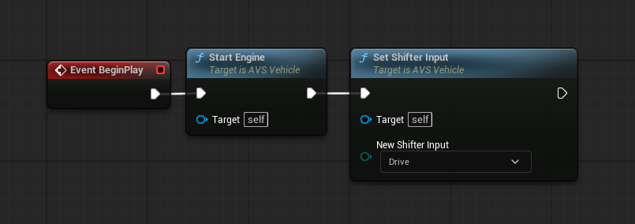
<!-- /side-by-side -->

Older screenshots and tutorials show a call to the parent function on Blueprint events. AVS 1.5 does not need it. It does no harm if it is there.

## Step 4: Connect the Inputs

<!-- side-by-side:48 -->
In the same event graph, connect each input to a vehicle function:

| Input | Vehicle function |
|---|---|
| VehicleForward | **Set Throttle Input** |
| VehicleBrake | **Set Brake Input** |
| VehicleSteering | **Set Steering Input** |
| Handbrake pressed / released | **Set Handbrake Input** (true / false) |
| ShifterUp | **Move Shifter Input**, **Move Up** true |
| ShifterDown | **Move Shifter Input**, **Move Up** false |
<!-- split -->
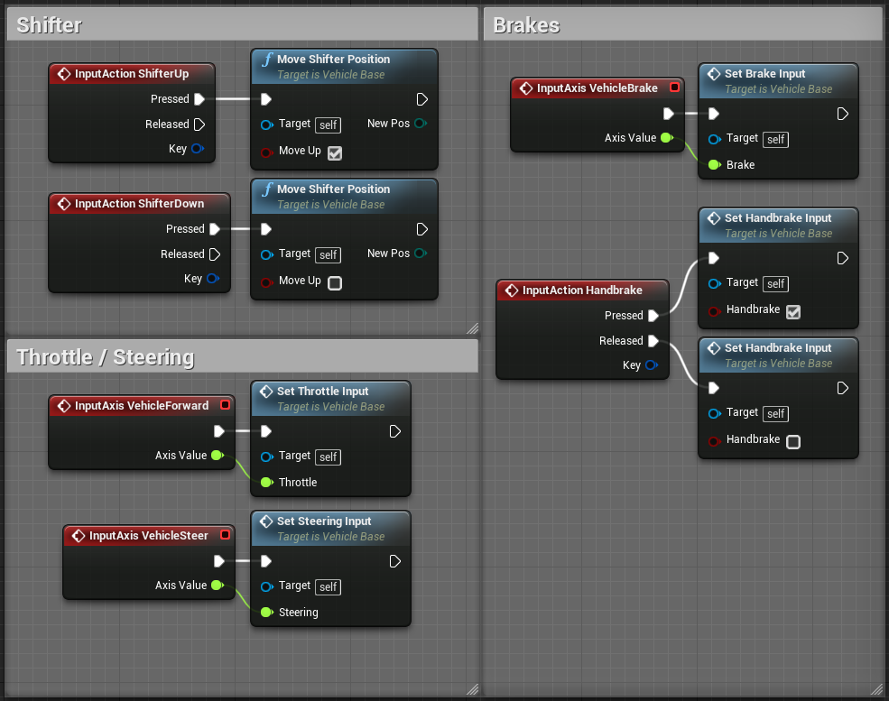
<!-- /side-by-side -->

The shifter goes Park, Reverse, Neutral, Drive. **Move Up** true moves toward Park.

## Optional: Automatic Shifting

With **Automatic Shifter Positon**, the car selects Drive and Reverse by itself, so the player never shifts. Pressing throttle from a stop selects Drive, and pressing brake from a stop selects Reverse.

<!-- side-by-side:50 -->
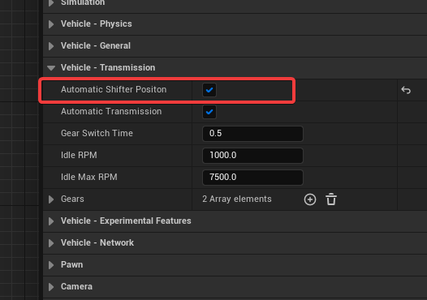
<!-- split -->
1. On the base Blueprint, turn on **Automatic Shifter Positon** under **Advanced Vehicle System → Transmission**.
2. Remove the **VehicleBrake** input, and add the brake keys to **VehicleForward** with a scale of `-1`.
3. In the event graph, remove the brake input, and replace **Set Throttle Input** with **Set Throttle And Brake Input**.
<!-- /side-by-side -->

<!-- side-by-side:50 -->
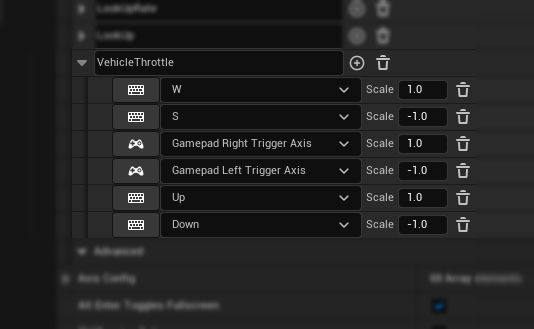
<!-- split -->
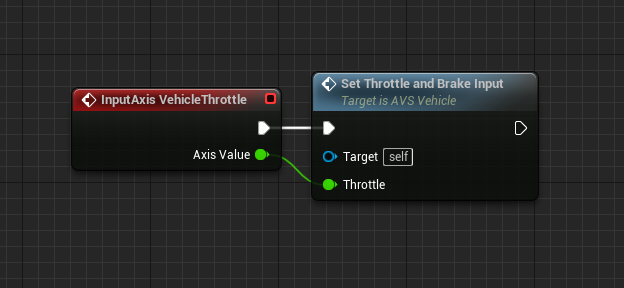
<!-- /side-by-side -->

**Set Throttle And Brake Input** treats negative values as brake, or as throttle while in Reverse. Automatic shifting needs it.

## Step 5: Create the Car

<!-- side-by-side:32 -->
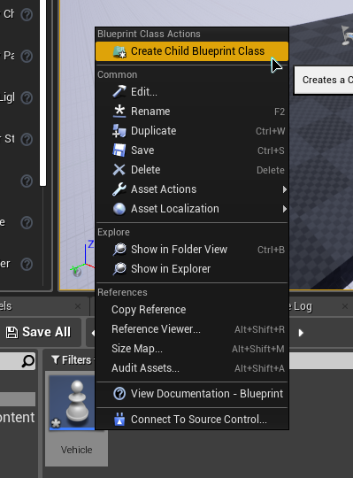
<!-- split -->
1. Right-click the base Blueprint and choose **Create Child Blueprint Class**. Name it `Car`.
2. Open `Car`, select the **VehicleMesh** component, and set its static mesh to your car body.
3. Under **Physics** on the same component, turn on **Mass (kg)** and set it to `1100`. A car much lighter than `1000` kg can shake and handle badly.
<!-- /side-by-side -->

**VehicleMesh** is the car's physics body. Its collision is the car's collision.

## Step 6: Add the Wheels

<!-- side-by-side:48 -->
1. Add four `AVS_Wheel` components under **VehicleMesh**. Name them after their corners, such as `WheelFrontLeft`.
2. Move each one to the center of its wheel, halfway through the wheel's suspension travel.
3. On each wheel, under **Advanced Vehicle System**, set **Wheel Static Mesh** to your wheel mesh.
<!-- split -->
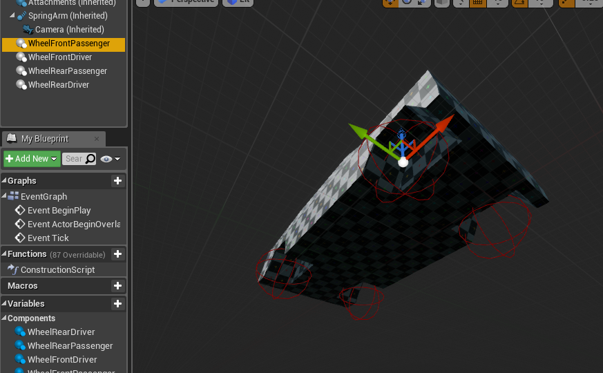
<!-- /side-by-side -->

AVS creates the wheel mesh from **Wheel Static Mesh** and measures the wheel's radius from it. Without a mesh, it uses a sphere.

<!-- side-by-side:57 -->
Then give the wheels their roles. For a rear wheel drive car:

- Front wheels: turn on **Is Steerable Wheel**.
- Rear wheels: turn on **Is Driving Wheel** and **Is Handbrake Wheel**.

**Is Braking Wheel** is on for every wheel by default. Leave it on.

If you rotated a wheel component 180 degrees so its mesh faces outward, turn on **Invert Torque** on it, or it drives the car backward.
<!-- split -->
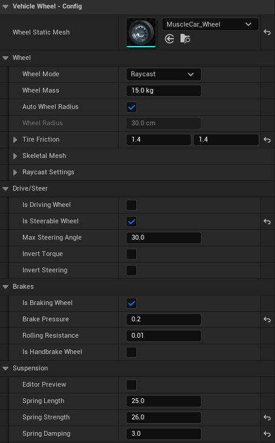
<!-- /side-by-side -->

Leave **Wheel Mode** on `Raycast`. The [Wheels](https://overtorque-creations.com/Dev/Docs/#AVS/Components/Wheels.md) page explains the wheel modes, suspension and grip.

## Step 7: Build the Gear Table

<!-- side-by-side:48 -->
1. Select `Car (self)` at the top of the components list, or press **Class Defaults**.
2. Open **Advanced Vehicle System → Transmission** and expand **Gears**. It has two gears to start with.
3. Add two more, and enter the values from the table below.

Gear `0` is reverse. Every gear after it is a forward gear.
<!-- split -->
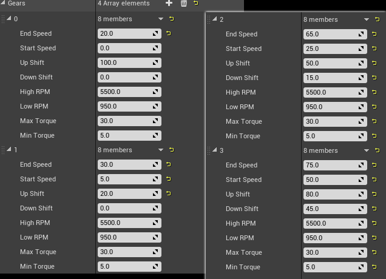
<!-- /side-by-side -->

| | Gear 0 (reverse) | Gear 1 | Gear 2 | Gear 3 |
|---|---|---|---|---|
| End Speed | 20.0 | 30.0 | 65.0 | 75.0 |
| Start Speed | 0.0 | 5.0 | 25.0 | 50.0 |
| Up Shift | 100.0 | 20.0 | 50.0 | 80.0 |
| Down Shift | 0.0 | 0.0 | 15.0 | 45.0 |
| High RPM | 5500.0 | 5500.0 | 5500.0 | 5500.0 |
| Low RPM | 950.0 | 950.0 | 950.0 | 950.0 |
| Max Torque | 30.0 | 30.0 | 30.0 | 30.0 |
| Min Torque | 5.0 | 5.0 | 5.0 | 5.0 |

Speeds are in the vehicle's **Speed Units** (`MPH` by default). Torque is in hectonewton meters: `30` is 3000 Nm at each driving wheel. RPM only affects engine sound and the HUD. [Engine and Transmission](https://overtorque-creations.com/Dev/Docs/#AVS/Configuration/Engine_And_Transmission.md) explains every value.

## Step 8: Turn On the Config Assist HUD

AVS includes a HUD that shows the car's speed, shifter, gear and torque, with sliders for the suspension.

On the base Blueprint, turn on **Display Debug Menu** under **Advanced Vehicle System → Debug**. The HUD appears whenever a local player possesses the car.

## Step 9: Drive the Car

1. Place a `Car` in your level, and set **Auto Possess Player** to **Player 0** in its details panel. Or set `Car` as the **Default Pawn Class** in your game mode.
2. Press Play.

The car starts in Drive. **ShifterUp** and **ShifterDown** move the shifter through Park, Reverse, Neutral and Drive, and the HUD shows the change.

<!-- side-by-side:57 -->
Press **Shift + F1** to get the mouse cursor and use the HUD's sliders. The spring sliders change every wheel at once while you drive. They are not saved, so copy the values you like back into the wheel components.
<!-- split -->
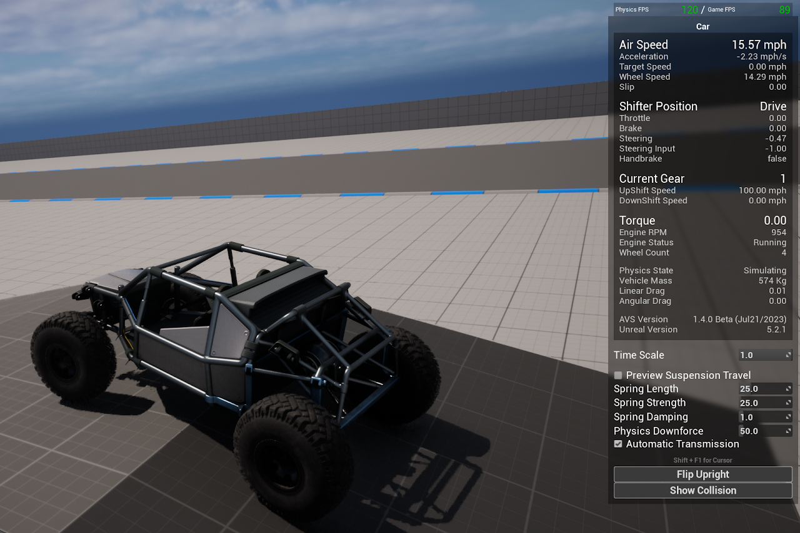
<!-- /side-by-side -->

If the car does not move, check that the engine started and the shifter is in Drive, then that the rear wheels have **Is Driving Wheel** on.

## Next Steps

- [Important Information](https://overtorque-creations.com/Dev/Docs/#AVS/Getting_Started/Important_Information.md): behavior to know before going further.
- [Wheels](https://overtorque-creations.com/Dev/Docs/#AVS/Components/Wheels.md): suspension and grip.
- [Engine and Transmission](https://overtorque-creations.com/Dev/Docs/#AVS/Configuration/Engine_And_Transmission.md): tuning the gear table.
- [Camera Pivot](https://overtorque-creations.com/Dev/Docs/#AVS/Components/Camera_Pivot.md): a camera with look input, lag and G-force movement.
- [Wheel Effects](https://overtorque-creations.com/Dev/Docs/#AVS/Wheel_Effects/Overview.md): tire smoke, skid marks and rolling sound.
