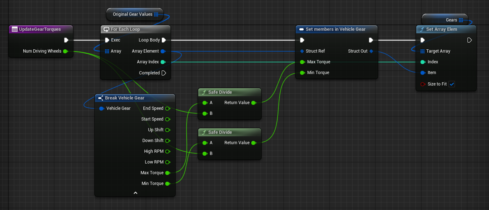

# Distributing Gear Torque Across Driving Wheels

The gear table's **Max Torque** and **Min Torque** are applied at each driving wheel. Two driving wheels produce twice the torque of one from the same table.

This page divides that torque across the driving wheels, so the gear table describes the whole drivetrain. A vehicle with a fixed number of driving wheels can be tuned without it.

## When to Divide Torque

- The number of driving wheels changes at runtime. A vehicle switching from two to four wheel drive doubles its torque on the switch.
- Vehicles are built from parts. Adding a driven axle makes the vehicle accelerate harder.
- One gear table is shared between vehicles with different numbers of driving wheels.

## Dividing the Gear Table by the Driving Wheel Count

1. Keep an untouched copy of your gear array, with the values as you authored them. The division runs against this copy each time. Dividing the live table again would divide it twice.
2. Write a function that loops the copy, divides each gear's **Max Torque** and **Min Torque** by the current number of driving wheels, and writes the result to the vehicle with `SetGearItem` or `SetGearArray`.
3. Call it at startup and whenever the number of driving wheels changes.

> Use a safe divide. A vehicle with no driving wheels would otherwise divide by zero.

The gear table now holds total drivetrain torque. Adding or removing a driving wheel splits the same total between more or fewer wheels.

## Uneven Torque Splits

Dividing the table gives every driving wheel the same torque. Giving one axle more torque than another needs per-wheel control:

- Physics mode wheels can be driven individually with `SetWheelTorque`. See [Wheels at Runtime](https://overtorque-creations.com/Dev/Docs/#AVS/Components/Wheels_At_Runtime.md).
- Raycast wheels all receive the vehicle's torque. Splitting it between them requires overriding the drivetrain in C++. See [Drivetrain and Physics Overrides](https://overtorque-creations.com/Dev/Docs/#AVS/Advanced/Physics_Overrides.md).
