# Skeletal Mesh AnimBP

How to animate a skeletal mesh's wheel and suspension bones from AVS wheels, with an AnimBP. The example is the Offroad Car from Unreal's vehicle template.

This works with raycast and physics wheels, with the wheels as separate meshes. To have physics wheels move the bones directly, without an AnimBP, see [Skeletal Wheels](https://overtorque-creations.com/Dev/Docs/#AVS/Skeletal_Mesh/Skeletal_Wheels.md).

## How It Works

The AVS wheels and their meshes do the driving. The skeletal mesh is only for looks.

Each frame, the AnimBP's event graph reads where each AVS wheel mesh is and stores it. The anim graph then moves the matching bones to those positions.

## Step 1: Create the AnimBP

<!-- side-by-side:57 -->
Right-click the skeletal mesh's skeleton and choose **Create → Anim Blueprint**.
<!-- split -->
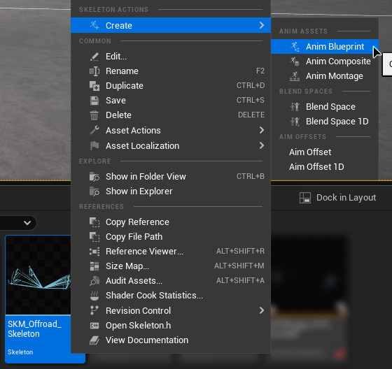
<!-- /side-by-side -->

## Step 2: Read the Wheel Positions in the Event Graph

<!-- side-by-side:41 -->
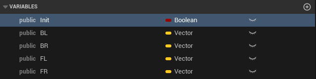
<!-- split -->
1. Create a vector variable for each wheel, such as `FL`, `FR`, `BL` and `BR`, and a boolean named `Init`.
<!-- /side-by-side -->

<!-- side-by-side:41 -->
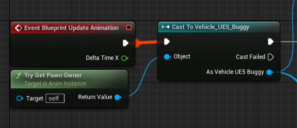
<!-- split -->
2. On **Event Blueprint Update Animation**, get **Try Get Pawn Owner** and cast it to your vehicle class.
<!-- /side-by-side -->

<!-- side-by-side:41 -->
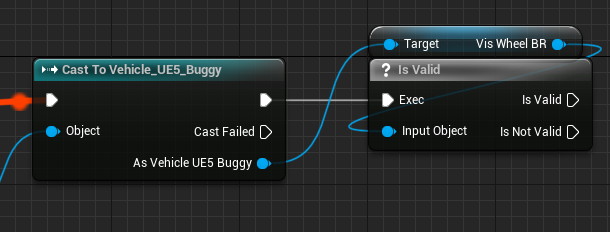
<!-- split -->
3. Check one of the vehicle's wheel components with **Is Valid**, and stop if it is not valid. While the vehicle is being constructed, the cast succeeds before the wheel components exist, and reading them would give errors for one frame.
<!-- /side-by-side -->

<!-- side-by-side:58 -->
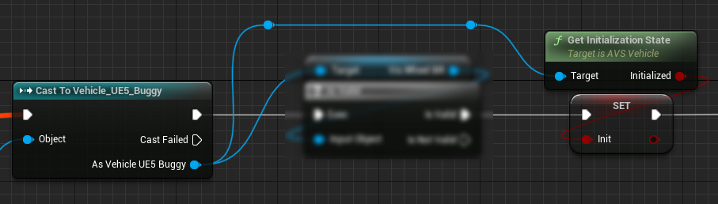
<!-- split -->
4. Store the vehicle's **Get Initialization State** in `Init`. It is true once AVS has finished setting the vehicle up.
<!-- /side-by-side -->

<!-- side-by-side:58 -->
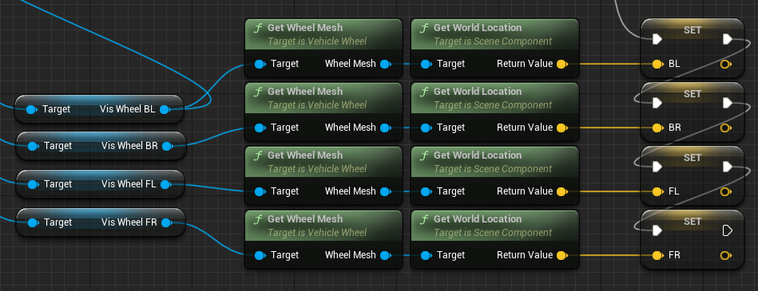
<!-- split -->
5. For each wheel, call **Get Wheel Mesh**, then **Get World Location**, and store the result in that wheel's variable.
<!-- /side-by-side -->

The finished event graph:

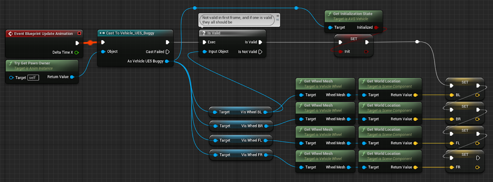

## Step 3: Move the Bones in the Anim Graph

<!-- side-by-side:58 -->
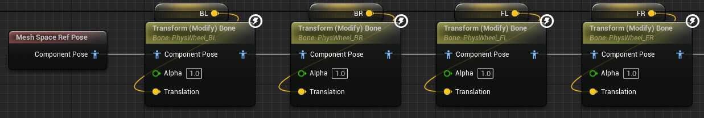
<!-- split -->
1. Add a **Transform (Modify) Bone** node for each wheel bone, in a chain, and connect each one's **Translation** to that wheel's variable.
2. On each node, set **Translation Mode** to **Replace Existing** and **Translation Space** to **World Space**.
<!-- /side-by-side -->

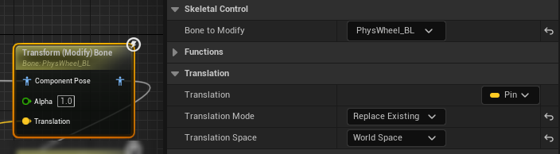

<!-- side-by-side:41 -->
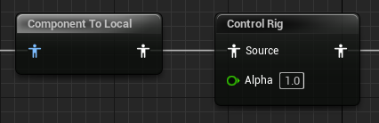
<!-- split -->
3. If the mesh has a Control Rig, such as the template Offroad Car's, add it after the bone nodes. This example uses the Offroad Car's Control Rig unchanged.
<!-- /side-by-side -->

<!-- side-by-side:58 -->
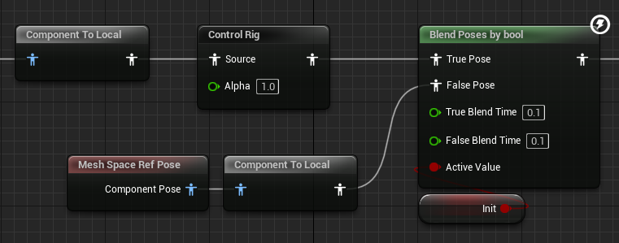
<!-- split -->
4. Add a **Blend Poses by bool** driven by `Init`. Use the animated pose when true, and the reference pose when false.

Until the vehicle is set up, and in the editor, the mesh then stays in its default pose. The demo's Offroad Car relies on this to snap its wheel components to the bone locations.
<!-- /side-by-side -->

The finished anim graph:

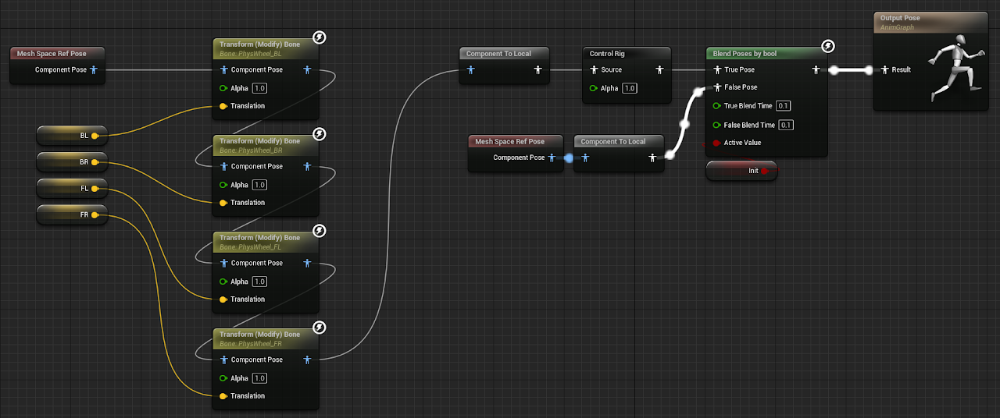

## Step 4: Test the Vehicle

Set the skeletal mesh component in your vehicle Blueprint to use the new AnimBP, then press Play. The wheel bones and suspension should follow the AVS wheels.

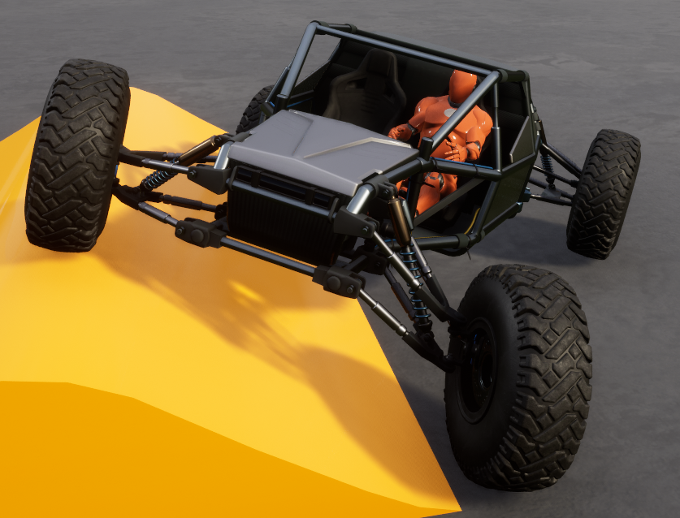

## Next Steps

- [Skeletal Wheels](https://overtorque-creations.com/Dev/Docs/#AVS/Skeletal_Mesh/Skeletal_Wheels.md): physics wheels moving the bones directly.
- [Wheels](https://overtorque-creations.com/Dev/Docs/#AVS/Components/Wheels.md): wheel modes, suspension and grip.
