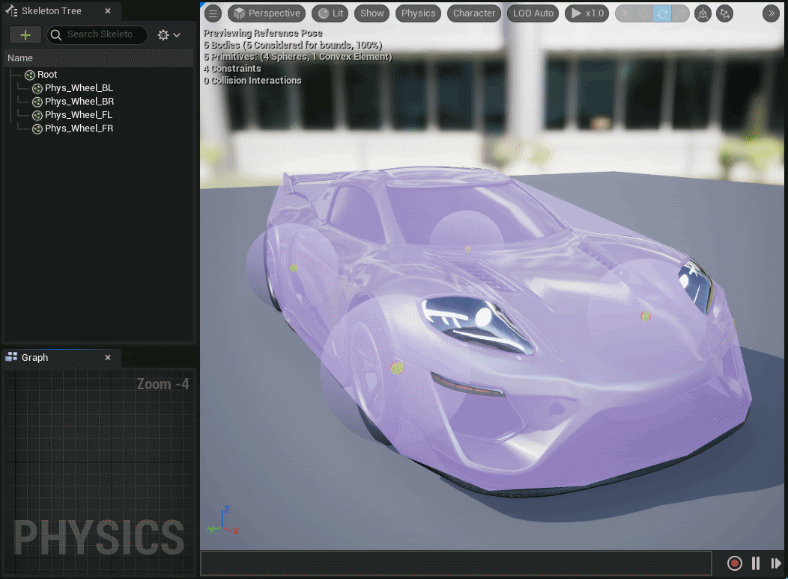
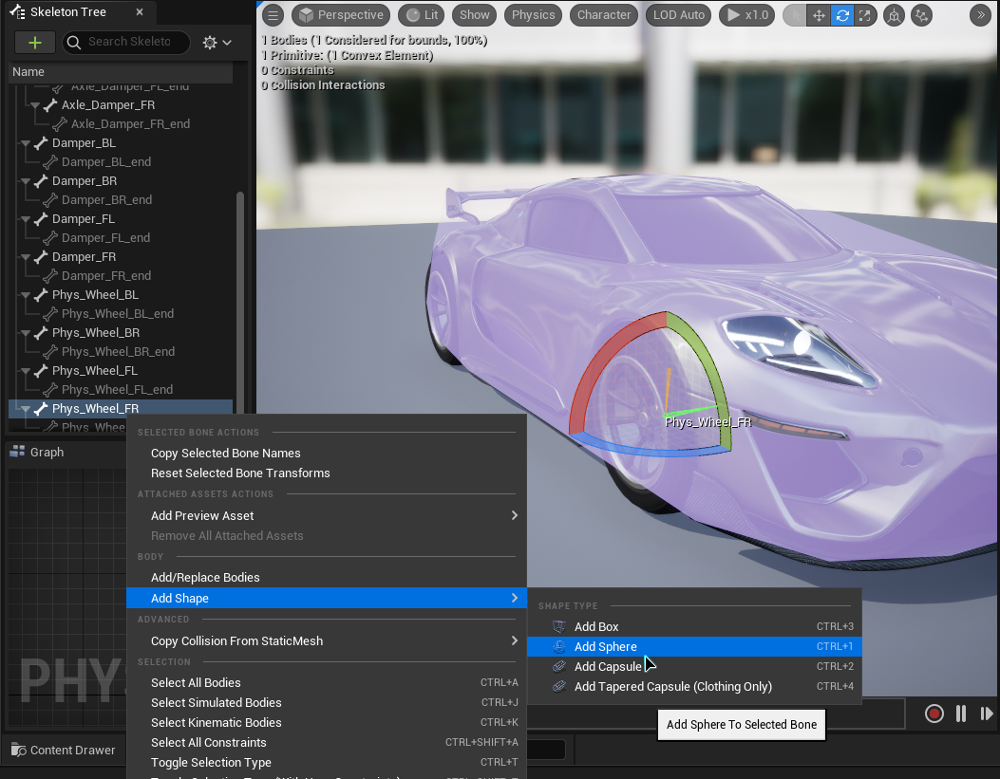
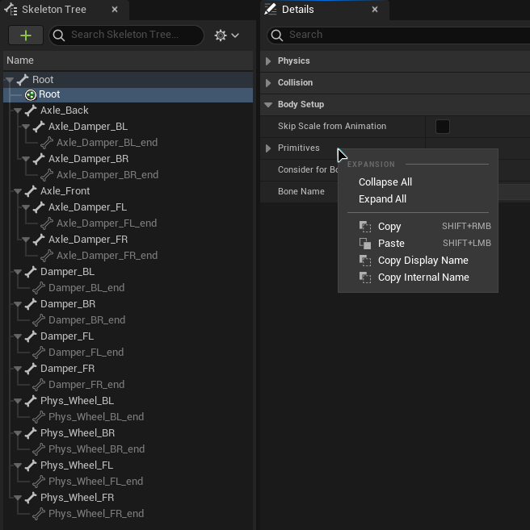
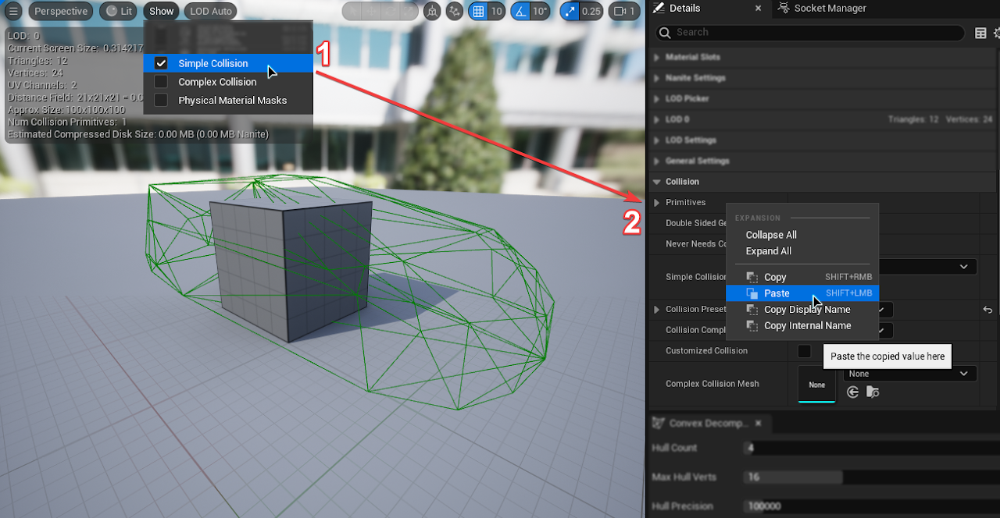
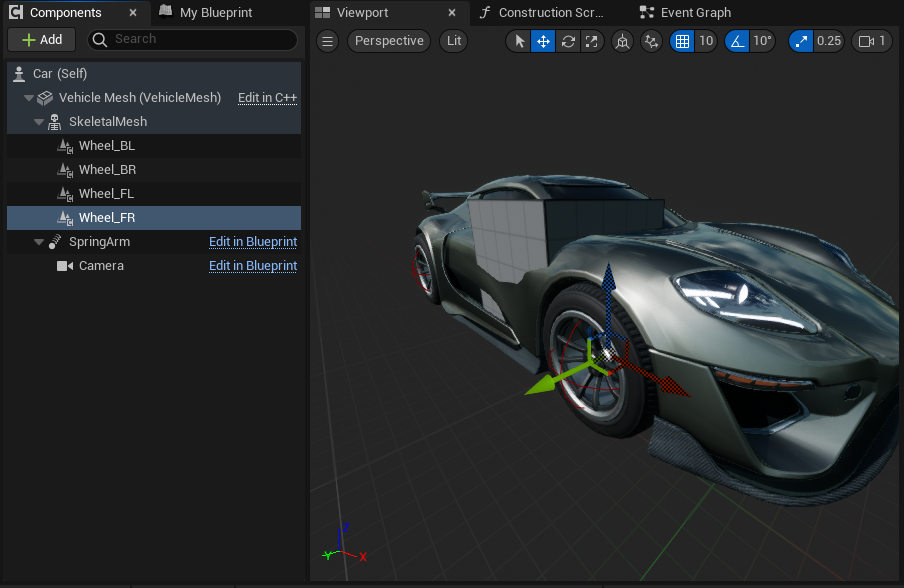
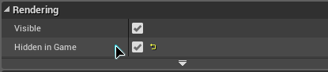
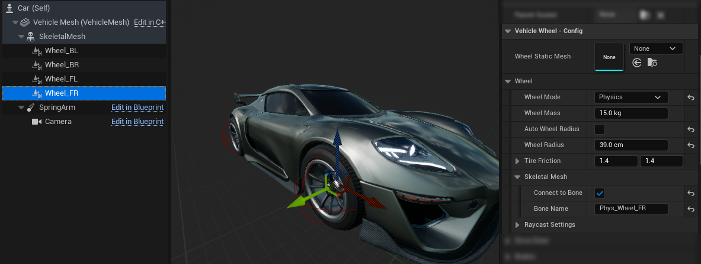
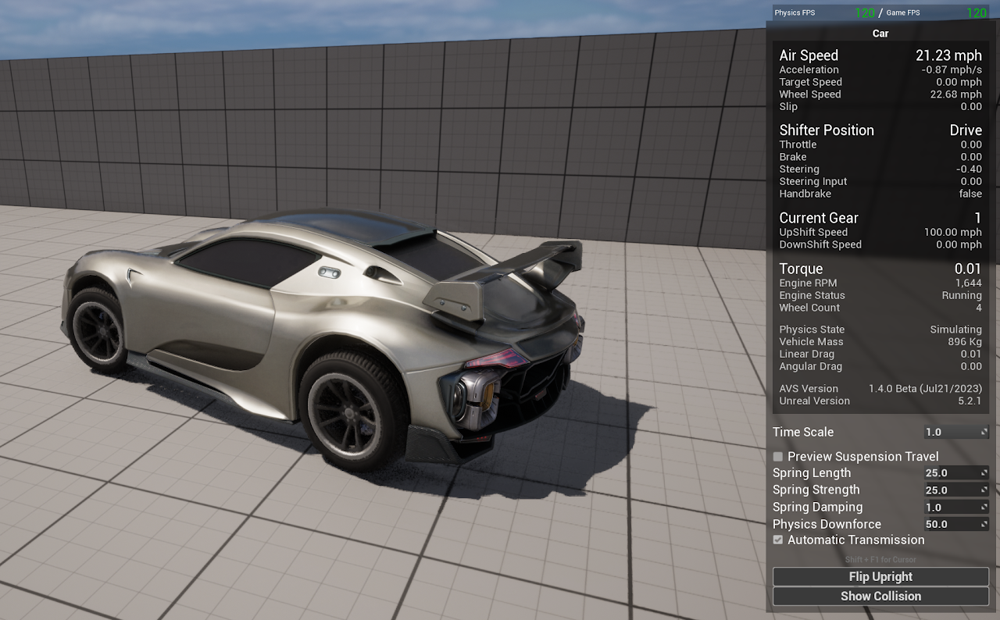
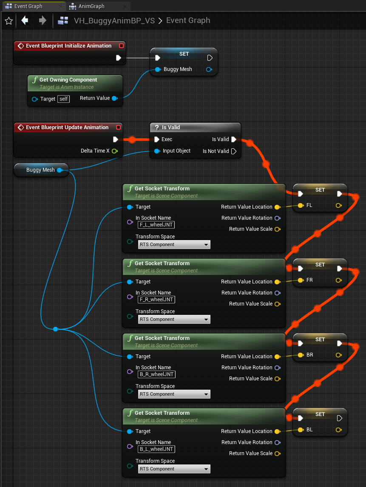
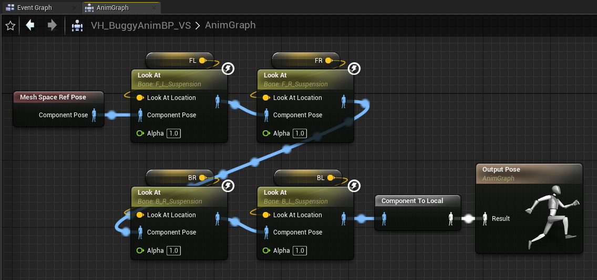

# Skeletal Mesh Wheels (Connect to Bone)

How to drive the wheel bones of a skeletal mesh with AVS wheels, using **Connect to Bone**. The example is the Sports Car from Unreal's vehicle template.

**Connect to Bone** only works with physics mode wheels. For raycast wheels, or a skeletal mesh with separate wheel meshes, see [Skeletal Animation](https://overtorque-creations.com/Dev/Docs/#AVS/Skeletal_Mesh/Skeletal_Animation.md).

## How Connect to Bone Works

An AVS vehicle's physics body is always a static mesh, `VehicleMesh`. A skeletal mesh is attached to it for looks.

With **Connect to Bone** on, a wheel sets its bone to simulate physics and joins the bone to the wheel with a locked constraint. The bone then follows the wheel exactly, with no AnimBP in between, so it is never a frame behind.

With **Wheel Reprojection** on, the bone is joined to the projected wheel mesh, since that is the one being shown.

## Step 1: Prepare the Physics Asset

<!-- side-by-side:48 -->
1. Open the skeletal mesh's Physics Asset, or create one.
2. Delete every constraint in it. Constraints in the Physics Asset make the parts jitter. See [Important Information](https://overtorque-creations.com/Dev/Docs/#AVS/Getting_Started/Important_Information.md).
<!-- split -->

<!-- /side-by-side -->

<!-- side-by-side:48 -->
3. Add a collision body for the car body, if it does not have one. This example uses a multi convex hull. Do not create constraints.
4. Add a shape to each wheel bone, if it does not have one. Its size does not matter. AVS uses it as a handle to move the bone, not for collision. If the wheel bones are not listed, turn on **Show All Bones** in the skeleton tree's settings.
<!-- split -->

<!-- /side-by-side -->

## Step 2: Make a Collision Mesh

The vehicle's collision comes from `VehicleMesh`, which must be a static mesh. If you already have a static mesh with the car's collision, use it and skip to Step 3.

Otherwise, copy the body collision from Step 1 onto a static mesh:

1. Duplicate any static mesh, such as a cube, into the skeletal mesh's folder. Name it something like `SM_SportsCar_Collision`. It is never drawn, so its shape does not matter.

<!-- side-by-side:48 -->
2. In the Physics Asset, select the car body's collision body. In the details panel, under **Body Setup**, right-click **Primitives** and choose **Copy**.
<!-- split -->

<!-- /side-by-side -->

<!-- side-by-side:32 -->
3. Open the new static mesh. Under **Collision**, right-click **Primitives** and choose **Paste**. If the collision does not show, turn on **Simple Collision** in the toolbar's **Collision** menu.
<!-- split -->

<!-- /side-by-side -->

## Step 3: Set Up the Vehicle

1. In your vehicle Blueprint, set **VehicleMesh** to the collision mesh.

<!-- side-by-side:40 -->
2. Add a **Skeletal Mesh** component under **VehicleMesh**, and set it to the car's skeletal mesh.
3. Move the wheel components under the skeletal mesh component.
<!-- split -->

<!-- /side-by-side -->

<!-- side-by-side:57 -->
4. On **VehicleMesh**, under **Rendering**, turn on **Hidden in Game**, or turn off **Visible** to hide it in the editor too.
<!-- split -->

<!-- /side-by-side -->

5. On each wheel:
   - Set **Wheel Mode** to `Physics`.
   - Turn on **Connect to Bone**, and enter the wheel's bone name in **Bone Name**. If the name is right, the wheel component moves to the bone.
   - Rotate the wheel component so its X axis points forward and its Z axis points up. The rotation does not snap to the bone.
   - Set **Wheel Static Mesh** if you want a wheel mesh. Without one, AVS uses a sphere.
   - Turn off **Auto Wheel Radius** and set **Wheel Radius** to the wheel's size, unless a **Wheel Static Mesh** of the right size is set.

## Step 4: Test the Car

Press Play and drive. Each wheel bone should follow its wheel component.

## Using an AnimBP With Connect to Bone

Because the wheel bones are moved by physics, the anim graph does not see their current positions. An AnimBP that needs them, for example to aim suspension arms at the wheels, has to read them in the event graph and store them.

<!-- side-by-side:50 -->

<!-- split -->
In the event graph:

1. On **Initialize Animation**, store the owning skeletal mesh component in a variable.
2. On **Update Animation**, read each wheel bone's location from that component with **Get Socket Transform**, and store each one in its own variable.
<!-- /side-by-side -->

<!-- side-by-side:40 -->
In the anim graph, use the stored locations in place of the bone positions. This example aims each suspension bone at its wheel with a **Look At** node.
<!-- split -->

<!-- /side-by-side -->

The demo project's Unreal Buggy uses this setup, in the AnimBP `VH_BuggyAnimBP_VS`.

## Fixing Skeletal Wheel Problems

### Wheel Bones Do Not Follow the Wheels

Check that the wheels are in `Physics` mode. In `Raycast` mode, **Connect to Bone** shows a warning and does nothing. Then check the **Bone Name** spelling, and that each wheel bone has a shape in the Physics Asset.

### Wheels Sit or Size Wrong on a Skeletal Mesh

A bone has a scale other than `1.0`. Unreal does not handle scaled bones here. Apply the scale in your modeling software and re-export, so every bone is at `1.0`.

## Next Steps

- [Skeletal Animation](https://overtorque-creations.com/Dev/Docs/#AVS/Skeletal_Mesh/Skeletal_Animation.md): skeletal meshes with raycast wheels.
- [Wheels](https://overtorque-creations.com/Dev/Docs/#AVS/Components/Wheels.md): wheel modes, suspension and grip.
